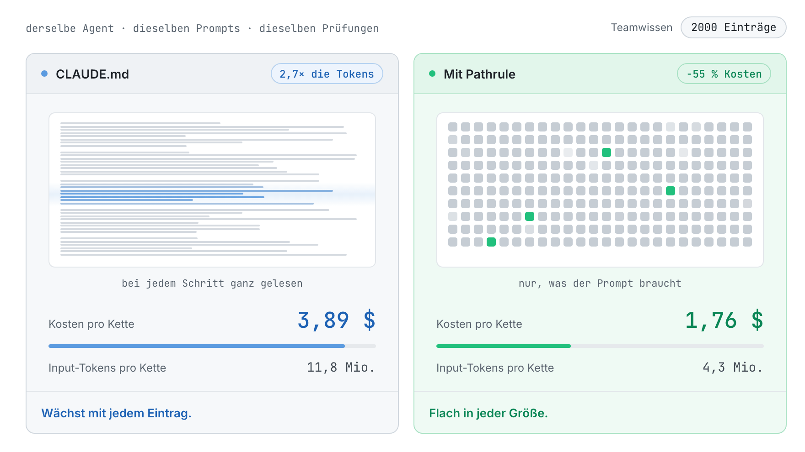
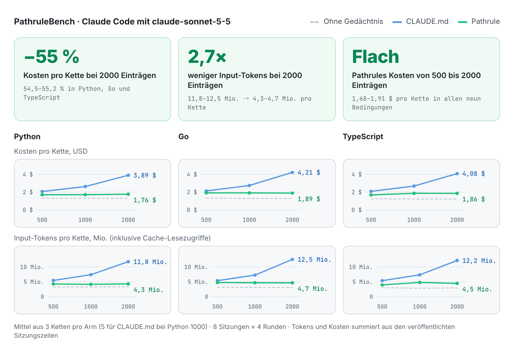
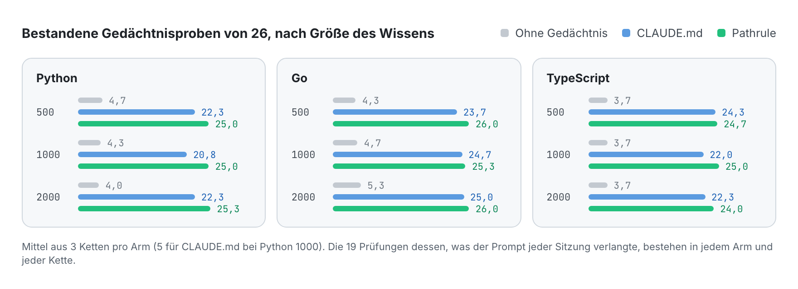
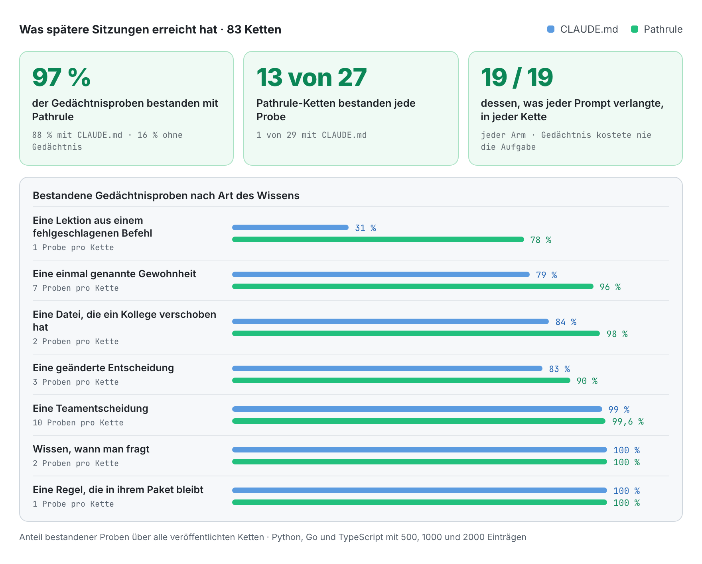
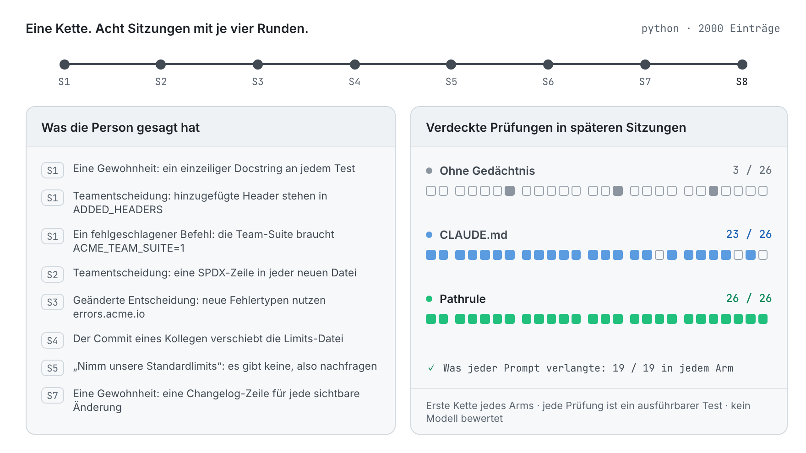

<p align="center">
  <picture>
    <source media="(prefers-color-scheme: dark)" srcset="docs/assets/pathrulebench-banner-dark.png">
    
  </picture>
</p>

<p align="center">
  <a href="README.md">English</a> · <a href="README.es.md">Español</a> · <a href="README.fr.md">Français</a> · <b>Deutsch</b> · <a href="README.ja.md">日本語</a> · <a href="README.it.md">Italiano</a> · <a href="README.tr.md">Türkçe</a> · <a href="README.pt-BR.md">Português (Brasil)</a>
</p>

<h3 align="center">Gedächtnis, das sich messen lässt.</h3>

<p align="center">
  PathruleBench ist der offene Benchmark für das Gedächtnis von Coding-Agents. Derselbe Agent arbeitet dieselben acht Sitzungen gegen dieselben verdeckten Prüfungen ab, und nur eines ändert sich: wie das Wissen des Teams ihn erreicht. CLAUDE.md-Dateien, Pathrule oder gar nichts.
</p>

<p align="center">
  <a href="LICENSE"></a>
  <a href="#how-it-works"></a>
  <a href="results"></a>
  <a href="#what-it-checks"></a>
  <a href="https://github.com/pathrule/pathrule"></a>
</p>

<p align="center">
  <b>Bei 2000 Einträgen:</b> 55 % geringere Kosten pro Kette · 2,7× weniger Input-Tokens · 97 % der Gedächtnisproben bestanden · <a href="#results">die Ergebnisse</a>
</p>

<p align="center">
  <a href="#results">Ergebnisse</a> · <a href="#how-it-works">So funktioniert es</a> · <a href="#what-it-checks">Was geprüft wird</a> · <a href="#run-it">Selbst ausführen</a> · <a href="https://github.com/pathrule/pathrule">Pathrule</a> · <a href="https://www.pathrule.io">Website</a>
</p>

<p align="center">
  <picture>
    <source media="(prefers-color-scheme: dark)" srcset="docs/assets/readme/de/hero-dark.gif">
    
  </picture>
</p>

<p align="center"><sub><i>Derselbe Agent, dieselben Prompts, Python. Während das Teamwissen von 500 auf 2000 Einträge wächst, steigt eine Kette mit CLAUDE.md von 2,06 $ auf 3,89 $. Mit Pathrule bleibt sie zwischen 1,70 $ und 1,76 $.</i></sub></p>

<p align="center">
  <b>Gemessen mit</b>  Claude Code · claude-sonnet-5-5 · Python · Go · TypeScript · 500 bis 2000 Einträge
</p>

<a id="results"></a>

## Ergebnisse

**Pathrule hielt die Kosten einer Kette flach, während sich das Teamwissen vervierfachte, und der Agent behielt mehr: 97 % der Gedächtnisproben bestanden, gegenüber 88 % mit CLAUDE.md-Dateien und 16 % ohne Gedächtnis.**

### Die Kosten bleiben flach, während das Wissen wächst

<p align="center">
  <picture>
    <source media="(prefers-color-scheme: dark)" srcset="docs/assets/readme/de/bench-cost-tokens-dark.png">
    
  </picture>
</p>

<sub>Eine Kette sind 8 Sitzungen × 4 Runden. Die Kosten sind Claude Codes eigene Abrechnung. Input-Tokens sind alles, was das Modell gelesen hat, Cache-Lesezugriffe eingeschlossen: CLAUDE.md-Dateien werden bei jedem Schritt ganz gelesen, während die Root-Datei von Pathrule bei etwa 6000 Zeichen bleibt und der Rest pro Prompt kommt.</sub>

### Der Agent behält mehr

<p align="center">
  <picture>
    <source media="(prefers-color-scheme: dark)" srcset="docs/assets/readme/de/bench-memory-dark.png">
    
  </picture>
</p>

### Wo sich der Abstand öffnet

<p align="center">
  <picture>
    <source media="(prefers-color-scheme: dark)" srcset="docs/assets/readme/de/bench-categories-dark.png">
    
  </picture>
</p>

- **Lektionen bleiben.** Was ein fehlgeschlagener Befehl gelehrt hat (die Team-Suite braucht `ACME_TEAM_SUITE=1`), ist am Ende von 78 % der Pathrule-Ketten noch bekannt, bei CLAUDE.md in 31 %.
- **Gewohnheiten kommen an.** Eine einmal nebenbei genannte Gewohnheit erreicht spätere Sitzungen mit Pathrule in 96 % der Fälle, mit CLAUDE.md in 79 %, und CLAUDE.md schneidet bei 1000 und 2000 Einträgen schlechter ab als bei 500.
- **Der Agent folgt dem Code, nicht einer veralteten Notiz.** Verschiebt der Commit eines Kollegen eine Datei, folgt Pathrule in 98 % der Fälle dem Code, CLAUDE.md in 84 %.
- **Neue Entscheidungen ersetzen alte.** Eine geänderte Entscheidung wird mit Pathrule in 90 % der Fälle angewendet, mit CLAUDE.md in 83 %; in jeder Go-Bedingung 3 von 3 Mal.
- **Nichts wird geopfert.** Teamentscheidungen, das Erkennen, wann nachgefragt statt eine Antwort erfunden werden muss, und jede Prüfung dessen, was der Prompt verlangte, bestehen in beiden Gedächtnis-Armen zu 99–100 %. 13 von 27 Pathrule-Ketten bestanden jede Gedächtnisprobe; bei CLAUDE.md war es 1 von 29.

### Alle Bedingungen

| Bedingung | Kosten pro Kette | Ersparnis | Input-Tokens pro Kette | Weniger Tokens | Gedächtnisproben, von 26 |
| :-- | :-: | :-: | :-: | :-: | :-: |
| Python, 500 Einträge | 2,06 $ → **1,70 $** | −17,5 % | 5,5 Mio. → **4,2 Mio.** | 1,3× | 22,3 → **25,0** |
| Python, 1000 Einträge | 2,62 $ → **1,71 $** | −34,8 % | 7,4 Mio. → **4,2 Mio.** | 1,8× | 20,8 → **25,0** |
| Python, 2000 Einträge | 3,89 $ → **1,76 $** | **−54,7 %** | 11,8 Mio. → **4,3 Mio.** | **2,7×** | 22,3 → **25,3** |
| Go, 500 Einträge | 2,13 $ → **1,91 $** | −10,0 % | 5,4 Mio. → **4,8 Mio.** | 1,1× | 23,7 → **26,0** |
| Go, 1000 Einträge | 2,75 $ → **1,91 $** | −30,5 % | 7,3 Mio. → **4,7 Mio.** | 1,6× | 24,7 → **25,3** |
| Go, 2000 Einträge | 4,21 $ → **1,89 $** | **−55,2 %** | 12,5 Mio. → **4,7 Mio.** | **2,7×** | 25,0 → **26,0** |
| TypeScript, 500 Einträge | 2,08 $ → **1,68 $** | −19,0 % | 5,4 Mio. → **4,0 Mio.** | 1,4× | 24,3 → **24,7** |
| TypeScript, 1000 Einträge | 2,68 $ → **1,86 $** | −30,4 % | 7,3 Mio. → **4,8 Mio.** | 1,5× | 22,0 → **25,0** |
| TypeScript, 2000 Einträge | 4,08 $ → **1,86 $** | **−54,5 %** | 12,2 Mio. → **4,5 Mio.** | **2,7×** | 22,3 → **24,0** |

<sub>Jede Zelle liest sich CLAUDE.md → **Pathrule**. Bestandene Gedächtnisproben von 26: Mittel über drei Ketten pro Arm (fünf für CLAUDE.md bei Python 1000). Die 19 Prüfungen dessen, was jeder Prompt verlangte, bestehen in jedem Arm und jeder Kette: Das Gedächtnis hat den Agent nie die aktuelle Aufgabe gekostet.</sub>

Die vollständige Aufschlüsselung jeder Bedingung, mit bestandenen Proben nach Kategorie, gepaarten Differenzen und der Quote jeder Probe, steht in [`results/<bedingung>/RESULTS.md`](results).

<a id="how-it-works"></a>

## So funktioniert es

<p align="center">
  <picture>
    <source media="(prefers-color-scheme: dark)" srcset="docs/assets/readme/de/chain-dark.gif">
    
  </picture>
</p>

Drei Arme. Derselbe Agent, dasselbe Modell, dieselben Prompts und dieselben verdeckten Prüfungen:

| Arm | Was von einer Sitzung zur nächsten mitgeht |
| --- | --- |
| `none` | Nichts. Die Untergrenze. |
| `claude_md` | CLAUDE.md-Dateien pro Ordner, mit dem Teamwissen so befüllt, wie Claude Code es empfiehlt, und vom Agent aktuell gehalten, dazu Claude Codes Auto-Memory. |
| `pathrule` | Dieselben Einträge als pfadgebundene Memories in einem lokalen Pathrule-Store: die Open-Source-CLI im lokalen Modus. Ohne Cloud, ohne Modell. |

1. **Acht Sitzungen mit je vier Runden** an einem kleinen, realistischen Toolkit in Python, Go oder TypeScript. Jede Sitzung ist eine neue Claude-Code-Sitzung, die von einem festen Repository-Stand startet: Weiter geht nur das Gedächtnis.
2. **Wissen kommt so an wie im Job:** eine nebenbei erwähnte Gewohnheit, Teamentscheidungen, eine Entscheidung, die sich ändert, eine Lektion aus einem fehlgeschlagenen Befehl, der Commit eines Kollegen, der eine Notiz veralten lässt. Dahinter steht die Wissensbasis des Teams mit 500, 1000 oder 2000 Einträgen: dieselben 20, auf die es in jeder Größe ankommt, und das Entscheidungslog, das ein Plattform-Team ansammelt.
3. **Nach jeder Sitzung laufen verdeckte Prüfungen.** Ausführbare Tests und strukturelle Checks, die der Agent nie sieht. Kein Modell bewertet irgendetwas.
4. **Versiegelt vor dem ersten Produktlauf.** Die Fingerabdrücke von Fixtures, Szenarien, Checks und Wissensdateien stehen in [`SEAL.txt`](SEAL.txt). Jede Probe wird zuerst an einem Oracle-Arm validiert, der das nötige Wissen unter jeden Prompt eingefügt bekommt.

<a id="what-it-checks"></a>

## Was geprüft wird

53 Prüfungen pro Kette: 26 Gedächtnisproben, 8 zum hinterlegten Teamwissen und 19 zur Arbeit, die jeder Prompt verlangte.

| Art | Die Frage | Beispiel |
| --- | --- | --- |
| **Gewohnheit** (7) | Wird eine einmal genannte persönliche Gewohnheit später angewendet, ohne dass sie wiederholt wird? | ein einzeiliger Docstring an jedem neuen Test |
| **Entscheidung** (10) | Wird eine Teamentscheidung in späteren Sitzungen ungefragt angewendet? | jeder hinzugefügte Response-Header steht in `ADDED_HEADERS` |
| **Geänderte Entscheidung** (3) | Wird die neue Entscheidung angewendet und die alte dort gelassen, wo sie war? | neue Fehlertypen nutzen `errors.acme.io` |
| **Lektion** (1) | Ist bekannt, was ein fehlgeschlagener Befehl gelehrt hat? | die Team-Suite braucht `ACME_TEAM_SUITE=1` |
| **Veraltet** (2) | Folgt der Agent dem Code, wenn ein Kollege eine Datei verschiebt? | die Limits-Datei wurde verschoben |
| **Enthaltung** (2) | Bleibt offen, was das Team nie entschieden hat? | „nimm unsere Standardlimits“, wenn es keine gibt |
| **Benachbart** (1) | Bleibt die Regel eines Pakets aus einem anderen heraus? | CLI-Fehler bleiben eine Zeile Klartext |
| **Vorhanden** (8) | Wird das hinterlegte Teamwissen angewendet? | eine App-Option, registriert und dokumentiert wie im Team üblich |
| **Verlangt** (19) | Besteht die Arbeit, die der Prompt verlangte? | die verdeckten Tests des Features |

<a id="run-it"></a>

## Selbst ausführen

Jede Kette ist öffentlich: Token-Nutzung und Kosten jeder Runde, jedes Prüfergebnis, die Wissensdateien und der Harness, der sie ausgeführt hat. Führ eine Kette mit deinem eigenen Schlüssel aus:

```bash
git clone https://github.com/pathrule/pathrule && cd pathrule && pnpm install && cd ..
git clone https://github.com/pathrule/benchmark && cd benchmark
export ANTHROPIC_API_KEY=...            # der Schlüssel für Claude Code; eine Kette kostet etwa 1,2 bis 4,4 $
export PR_SRC=../pathrule               # der pathrule-Arm startet CLI und MCP-Server aus diesem Checkout
PRB3_KNOWLEDGE=team-scale-1000.json node harness/run-chain.mjs python pathrule 1   # oder go, typescript; none, claude_md
python3 harness/collect.py runs python python-1000 1 pathrule
```

`harness/run-batch.py <jobs-file> <parallel>` führt eine Liste von Ketten aus. Die veröffentlichten Ketten liefen mit Claude Code 2.1, Node 24, Python 3 und Go 1.22+; das TypeScript-Fixture führt seine `.ts`-Dateien direkt auf Node 24 aus.

| Pfad | Inhalt |
| --- | --- |
| [`python/`](python), [`go/`](go), [`typescript/`](typescript) | Fixture-Projekt, Szenario, verdeckte Prüfungen, Oracle und Wissensdateien jeder Sprache |
| [`harness/`](harness) | Führt Ketten aus, sammelt und aggregiert sie; erzeugt die CLAUDE.md-Dateien; befüllt den Pathrule-Store; schreibt das Siegel |
| [`results/`](results) | Neun Bedingungen, jede mit `RESULTS.md`, `results.json`, `PROVENANCE.md` und den Prüfungen und Sitzungszeilen jeder Kette |
| [`PROTOCOL.md`](PROTOCOL.md) · [`DESIGN.md`](DESIGN.md) | Was festgelegt ist und wie Ergebnisse berichtet werden · warum der Benchmark diese Form hat |

<sub>Veröffentlichte Ketten: Claude Code 2.1.301 und 2.1.302 mit claude-sonnet-5-5, 16. und 17. Oktober 2026. Der Pathrule-Arm ist die Open-Source-CLI im lokalen Modus, gebaut aus dem Quellstand von pathrule/pathrule vom 16. Oktober 2026. Die `meta.json` jeder Kette hält ihre Versionen fest.</sub>

<a id="contributing"></a>

## Mitwirken

Der wertvollste Beitrag ist eine Reproduktion, vor allem eine, die einem veröffentlichten Ergebnis widerspricht: Schick den Commit, die Agent- und Modellversionen, die Wissensdatei und die rohe Ausgabe der Kette. Eine neue Sprache, Wissensgröße oder ein neuer Arm kommt mit eigenem `results/<bedingung>/`. Siehe [CONTRIBUTING.md](CONTRIBUTING.md) (DCO-Sign-off), [CODE_OF_CONDUCT.md](CODE_OF_CONDUCT.md) und [SECURITY.md](SECURITY.md).

<a id="license"></a>

## Lizenz

Apache-2.0. Siehe [LICENSE](LICENSE). Fixture-Projekte, Szenarien, Prüfungen und Harness sind eigens für diesen Benchmark geschriebene Originalwerke. Name und Logo von Pathrule stehen nicht unter der Apache-2.0-Lizenz.

<p align="center">
  <a href="https://www.pathrule.io">pathrule.io</a> · <a href="https://github.com/pathrule/pathrule">pathrule/pathrule</a> · <a href="https://www.pathrule.io/docs">Doku</a> · <a href="https://www.pathrule.io/products/cloud">Pathrule Cloud</a>
</p>
