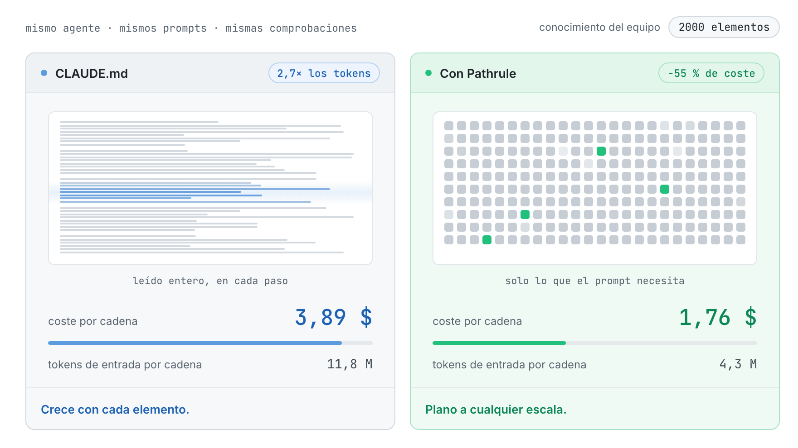
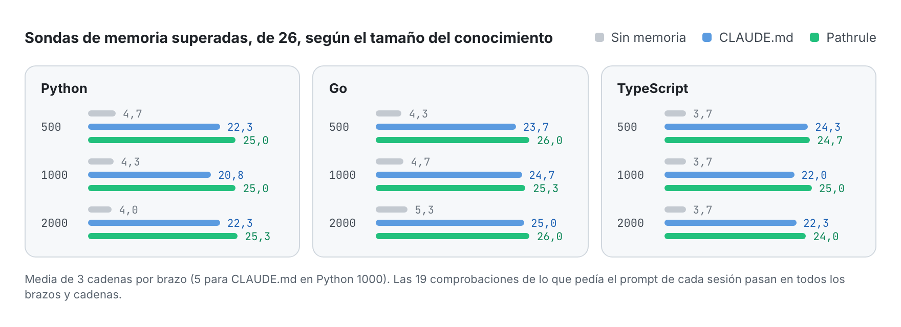
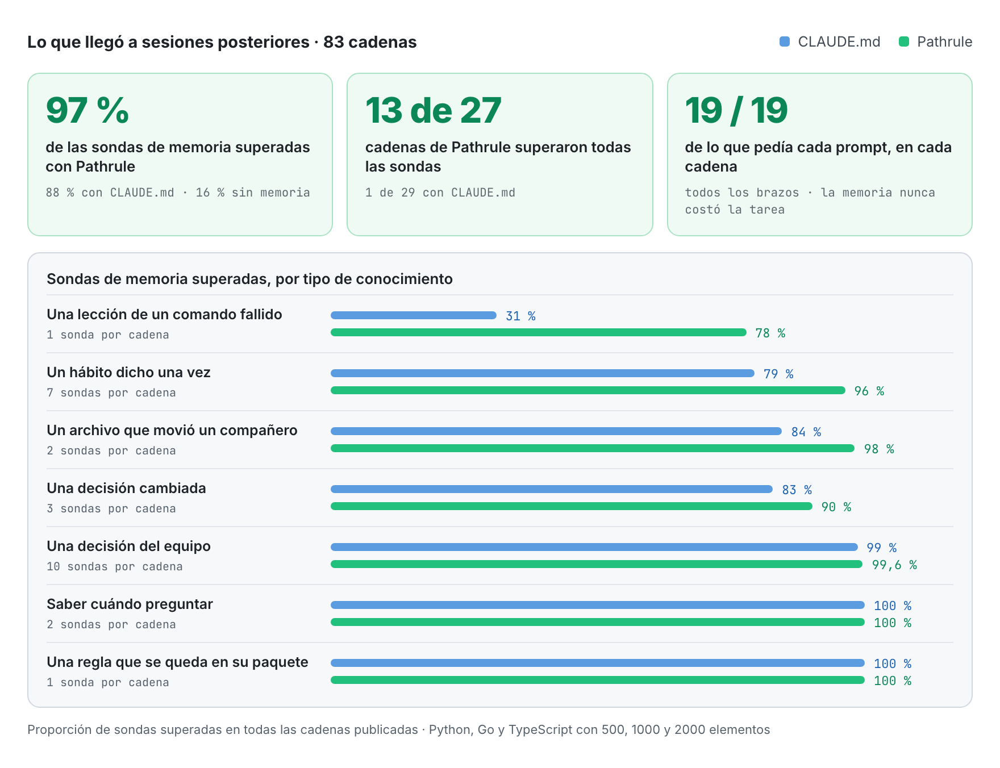
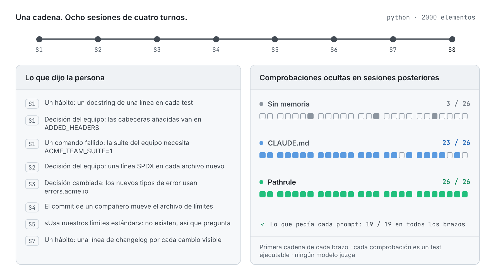

<p align="center">
  <picture>
    <source media="(prefers-color-scheme: dark)" srcset="docs/assets/pathrulebench-banner-dark.png">
    
  </picture>
</p>

<p align="center">
  <a href="README.md">English</a> · <b>Español</b> · <a href="README.fr.md">Français</a> · <a href="README.de.md">Deutsch</a> · <a href="README.ja.md">日本語</a> · <a href="README.it.md">Italiano</a> · <a href="README.tr.md">Türkçe</a> · <a href="README.pt-BR.md">Português (Brasil)</a>
</p>

<h3 align="center">Memoria que se puede medir.</h3>

<p align="center">
  PathruleBench es el benchmark abierto de memoria para agentes de programación. El mismo agente recorre las mismas ocho sesiones frente a las mismas comprobaciones ocultas, y solo cambia una cosa: cómo le llega el conocimiento del equipo. Archivos CLAUDE.md, Pathrule o nada.
</p>

<p align="center">
  <a href="LICENSE"></a>
  <a href="#how-it-works"></a>
  <a href="results"></a>
  <a href="#what-it-checks"></a>
  <a href="https://github.com/pathrule/pathrule"></a>
</p>

<p align="center">
  <b>Con 2000 elementos:</b> 55 % menos coste por cadena · 2,7× menos tokens de entrada · 97 % de sondas de memoria superadas · <a href="#results">los resultados</a>
</p>

<p align="center">
  <a href="#results">Resultados</a> · <a href="#how-it-works">Cómo funciona</a> · <a href="#what-it-checks">Qué comprueba</a> · <a href="#run-it">Ejecútalo tú</a> · <a href="https://github.com/pathrule/pathrule">Pathrule</a> · <a href="https://www.pathrule.io">Web</a>
</p>

<p align="center">
  <picture>
    <source media="(prefers-color-scheme: dark)" srcset="docs/assets/readme/es/hero-dark.gif">
    
  </picture>
</p>

<p align="center"><sub><i>Mismo agente, mismos prompts, Python. Mientras el conocimiento del equipo crece de 500 a 2000 elementos, una cadena con CLAUDE.md pasa de 2,06 $ a 3,89 $. Con Pathrule se queda entre 1,70 $ y 1,76 $.</i></sub></p>

<p align="center">
  <b>Medido con</b>  Claude Code · claude-sonnet-5-5 · Python · Go · TypeScript · de 500 a 2000 elementos
</p>

<a id="results"></a>

## Resultados

**Pathrule mantuvo plano el coste de una cadena mientras el conocimiento del equipo se multiplicaba por cuatro, y el agente recordó más: superó el 97 % de las sondas de memoria, frente al 88 % con archivos CLAUDE.md y el 16 % sin memoria.**

### El coste se mantiene plano aunque crezca el conocimiento

<p align="center">
  <picture>
    <source media="(prefers-color-scheme: dark)" srcset="docs/assets/readme/es/bench-cost-tokens-dark.png">
    
  </picture>
</p>

<sub>Una cadena son 8 sesiones × 4 turnos. El coste es la contabilidad del propio Claude Code. Los tokens de entrada son todo lo que leyó el modelo, lecturas de caché incluidas: los archivos CLAUDE.md se leen enteros en cada paso, mientras que el archivo raíz de Pathrule se queda en unos 6000 caracteres y el resto llega por prompt.</sub>

### El agente recuerda más

<p align="center">
  <picture>
    <source media="(prefers-color-scheme: dark)" srcset="docs/assets/readme/es/bench-memory-dark.png">
    
  </picture>
</p>

### Dónde se abre la diferencia

<p align="center">
  <picture>
    <source media="(prefers-color-scheme: dark)" srcset="docs/assets/readme/es/bench-categories-dark.png">
    
  </picture>
</p>

- **Las lecciones se quedan.** Lo que enseñó un comando fallido (la suite del equipo necesita `ACME_TEAM_SUITE=1`) se sigue sabiendo al final del 78 % de las cadenas de Pathrule y del 31 % de las de CLAUDE.md.
- **Los hábitos llegan.** Un hábito dicho una vez, de pasada, llega a sesiones posteriores el 96 % de las veces con Pathrule y el 79 % con CLAUDE.md, que rinde peor con 1000 y 2000 elementos que con 500.
- **El agente sigue al código, no a una nota desfasada.** Cuando el commit de un compañero mueve un archivo, Pathrule sigue al código el 98 % de las veces; CLAUDE.md, el 84 %.
- **Las decisiones nuevas sustituyen a las viejas.** Una decisión cambiada se aplica el 90 % de las veces con Pathrule y el 83 % con CLAUDE.md; en todas las condiciones de Go, 3 de 3.
- **No se sacrifica nada.** Las decisiones del equipo, saber cuándo preguntar en lugar de inventar una respuesta y cada comprobación de lo que pedía el prompt pasan al 99–100 % en los dos brazos con memoria. 13 de 27 cadenas de Pathrule superaron todas las sondas de memoria; de las de CLAUDE.md, 1 de 29.

### Todas las condiciones

| Condición | Coste por cadena | Ahorro | Tokens de entrada por cadena | Menos tokens | Sondas de memoria, de 26 |
| :-- | :-: | :-: | :-: | :-: | :-: |
| Python, 500 elementos | 2,06 $ → **1,70 $** | −17,5 % | 5,5 M → **4,2 M** | 1,3× | 22,3 → **25,0** |
| Python, 1000 elementos | 2,62 $ → **1,71 $** | −34,8 % | 7,4 M → **4,2 M** | 1,8× | 20,8 → **25,0** |
| Python, 2000 elementos | 3,89 $ → **1,76 $** | **−54,7 %** | 11,8 M → **4,3 M** | **2,7×** | 22,3 → **25,3** |
| Go, 500 elementos | 2,13 $ → **1,91 $** | −10,0 % | 5,4 M → **4,8 M** | 1,1× | 23,7 → **26,0** |
| Go, 1000 elementos | 2,75 $ → **1,91 $** | −30,5 % | 7,3 M → **4,7 M** | 1,6× | 24,7 → **25,3** |
| Go, 2000 elementos | 4,21 $ → **1,89 $** | **−55,2 %** | 12,5 M → **4,7 M** | **2,7×** | 25,0 → **26,0** |
| TypeScript, 500 elementos | 2,08 $ → **1,68 $** | −19,0 % | 5,4 M → **4,0 M** | 1,4× | 24,3 → **24,7** |
| TypeScript, 1000 elementos | 2,68 $ → **1,86 $** | −30,4 % | 7,3 M → **4,8 M** | 1,5× | 22,0 → **25,0** |
| TypeScript, 2000 elementos | 4,08 $ → **1,86 $** | **−54,5 %** | 12,2 M → **4,5 M** | **2,7×** | 22,3 → **24,0** |

<sub>Cada celda se lee CLAUDE.md → **Pathrule**. Sondas de memoria superadas, de 26: media de tres cadenas por brazo (cinco para CLAUDE.md en Python 1000). Las 19 comprobaciones de lo que pedía cada prompt pasan en todos los brazos y todas las cadenas: la memoria nunca le costó al agente la tarea que tenía delante.</sub>

El desglose completo de cada condición, con los aciertos por categoría, las diferencias pareadas y la tasa de cada sonda, está en [`results/<condición>/RESULTS.md`](results).

<a id="how-it-works"></a>

## Cómo funciona

<p align="center">
  <picture>
    <source media="(prefers-color-scheme: dark)" srcset="docs/assets/readme/es/chain-dark.gif">
    
  </picture>
</p>

Tres brazos. El mismo agente, el mismo modelo, los mismos prompts y las mismas comprobaciones ocultas:

| Brazo | Qué pasa de una sesión a la siguiente |
| --- | --- |
| `none` | Nada. El suelo. |
| `claude_md` | Archivos CLAUDE.md por carpeta, sembrados con el conocimiento del equipo como recomienda Claude Code y mantenidos al día por el agente, más la memoria automática de Claude Code. |
| `pathrule` | Los mismos elementos como memorias ligadas a rutas en un almacén local de Pathrule: la CLI de código abierto en modo local. Sin Cloud, sin modelo. |

1. **Ocho sesiones de cuatro turnos** sobre un toolkit pequeño y realista en Python, Go o TypeScript. Cada sesión es una sesión nueva de Claude Code que parte de un estado fijo del repositorio, así que solo la memoria pasa adelante.
2. **El conocimiento llega como llega en el trabajo:** un hábito mencionado de pasada, decisiones del equipo, una decisión que cambia, una lección que enseña un comando fallido, el commit de un compañero que deja una nota desfasada. Detrás está la base de conocimiento del equipo, con 500, 1000 o 2000 elementos: los mismos 20 que importan en cada tamaño y el registro de decisiones que acumula un equipo de plataforma.
3. **Las comprobaciones ocultas se ejecutan tras cada sesión.** Tests ejecutables y comprobaciones estructurales que el agente nunca ve. Ningún modelo juzga nada.
4. **Sellado antes de la primera ejecución del producto.** Las huellas de fixtures, escenarios, comprobaciones y archivos de conocimiento están en [`SEAL.txt`](SEAL.txt). Cada sonda se valida primero con un brazo oráculo que tiene pegado bajo cada prompt el conocimiento que necesita.

<a id="what-it-checks"></a>

## Qué comprueba

53 comprobaciones por cadena: 26 sondas de memoria, 8 sobre el conocimiento sembrado del equipo y 19 sobre el trabajo que pedía cada prompt.

| Tipo | La pregunta | Ejemplo |
| --- | --- | --- |
| **Hábito** (7) | ¿Se aplica después, sin repetirlo, un hábito personal dicho una vez? | un docstring de una línea en cada test nuevo |
| **Decisión** (10) | ¿Se aplica una decisión del equipo en sesiones posteriores sin recordarla? | cada cabecera de respuesta añadida figura en `ADDED_HEADERS` |
| **Decisión cambiada** (3) | ¿Se aplica la decisión nueva y se deja la antigua donde estaba? | los nuevos tipos de error usan `errors.acme.io` |
| **Lección** (1) | ¿Se sigue sabiendo lo que enseñó un comando fallido? | la suite del equipo necesita `ACME_TEAM_SUITE=1` |
| **Desfasado** (2) | Cuando un compañero mueve un archivo, ¿el agente sigue al código? | el archivo de límites se movió |
| **Abstención** (2) | ¿Se deja sin decidir lo que el equipo nunca decidió? | «usa nuestros límites estándar» cuando no existen |
| **Adyacente** (1) | ¿Una regla de un paquete se queda fuera de otro? | los errores de la CLI siguen siendo una línea de texto plano |
| **Presente** (8) | ¿Se aplica el conocimiento sembrado del equipo? | una opción de la app registrada y documentada como hace el equipo |
| **Pedido** (19) | ¿Pasa el trabajo que pidió el prompt? | los tests ocultos de la funcionalidad |

<a id="run-it"></a>

## Ejecútalo tú

Todas las cadenas son públicas: el uso de tokens y el coste de cada turno, cada resultado de comprobación, los archivos de conocimiento y el harness que las ejecutó. Ejecuta una cadena con tu propia clave:

```bash
git clone https://github.com/pathrule/pathrule && cd pathrule && pnpm install && cd ..
git clone https://github.com/pathrule/benchmark && cd benchmark
export ANTHROPIC_API_KEY=...            # la clave de Claude Code; una cadena cuesta entre 1,2 $ y 4,4 $
export PR_SRC=../pathrule               # el brazo pathrule ejecuta la CLI y el servidor MCP desde este checkout
PRB3_KNOWLEDGE=team-scale-1000.json node harness/run-chain.mjs python pathrule 1   # o go, typescript; none, claude_md
python3 harness/collect.py runs python python-1000 1 pathrule
```

`harness/run-batch.py <jobs-file> <parallel>` ejecuta una lista de cadenas. Las cadenas publicadas se ejecutaron con Claude Code 2.1, Node 24, Python 3 y Go 1.22+; el fixture de TypeScript ejecuta sus archivos `.ts` directamente en Node 24.

| Ruta | Qué contiene |
| --- | --- |
| [`python/`](python), [`go/`](go), [`typescript/`](typescript) | El proyecto fixture, el escenario, las comprobaciones ocultas, el oráculo y los archivos de conocimiento de cada lenguaje |
| [`harness/`](harness) | Ejecuta, recoge y agrega cadenas; genera los archivos CLAUDE.md; siembra el almacén de Pathrule; escribe el sello |
| [`results/`](results) | Nueve condiciones, cada una con `RESULTS.md`, `results.json`, `PROVENANCE.md` y las comprobaciones y filas de sesión de cada cadena |
| [`PROTOCOL.md`](PROTOCOL.md) · [`DESIGN.md`](DESIGN.md) | Qué queda fijo y cómo se informan los resultados · por qué el benchmark tiene esta forma |

<sub>Cadenas publicadas: Claude Code 2.1.301 y 2.1.302 con claude-sonnet-5-5, 16 y 17 de octubre de 2026. El brazo de Pathrule es la CLI de código abierto en modo local, compilada desde el código de pathrule/pathrule del 16 de octubre de 2026. El `meta.json` de cada cadena registra sus versiones.</sub>

<a id="contributing"></a>

## Contribuir

La contribución más valiosa es una reproducción, sobre todo si no coincide con un resultado publicado: envía el commit, las versiones del agente y del modelo, el archivo de conocimiento y la salida en bruto de la cadena. Un lenguaje, un tamaño de conocimiento o un brazo nuevos llegan con su propio `results/<condición>/`. Consulta [CONTRIBUTING.md](CONTRIBUTING.md) (firma DCO), [CODE_OF_CONDUCT.md](CODE_OF_CONDUCT.md) y [SECURITY.md](SECURITY.md).

<a id="license"></a>

## Licencia

Apache-2.0. Consulta [LICENSE](LICENSE). Los proyectos fixture, los escenarios, las comprobaciones y el harness son obra original escrita para este benchmark. El nombre y el logotipo de Pathrule no están licenciados bajo Apache-2.0.

<p align="center">
  <a href="https://www.pathrule.io">pathrule.io</a> · <a href="https://github.com/pathrule/pathrule">pathrule/pathrule</a> · <a href="https://www.pathrule.io/docs">Documentación</a> · <a href="https://www.pathrule.io/products/cloud">Pathrule Cloud</a>
</p>
