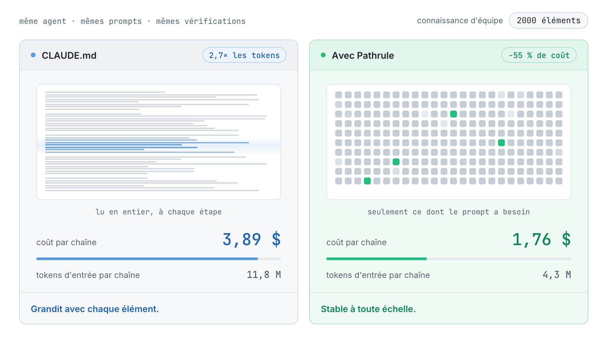
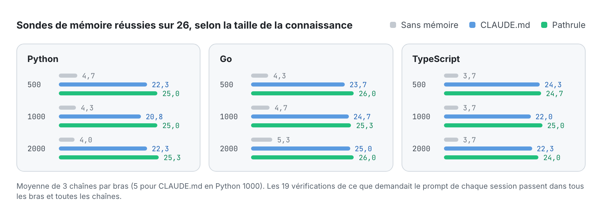
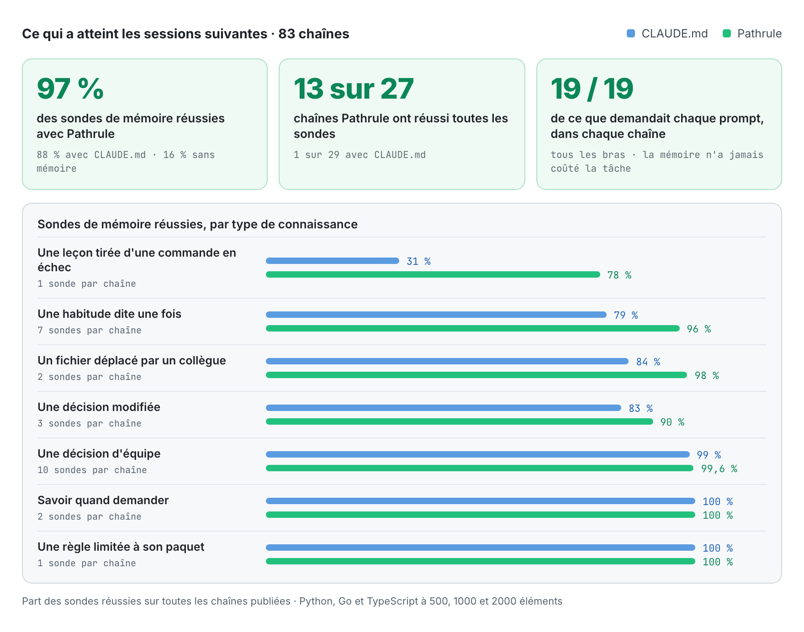
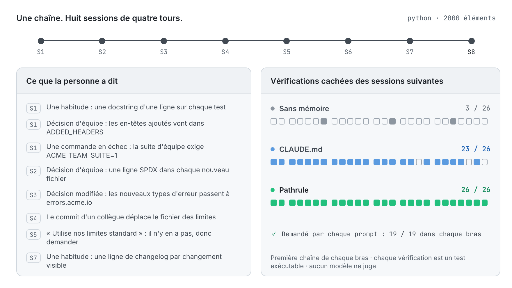

<p align="center">
  <picture>
    <source media="(prefers-color-scheme: dark)" srcset="docs/assets/pathrulebench-banner-dark.png">
    
  </picture>
</p>

<p align="center">
  <a href="README.md">English</a> · <a href="README.es.md">Español</a> · <b>Français</b> · <a href="README.de.md">Deutsch</a> · <a href="README.ja.md">日本語</a> · <a href="README.it.md">Italiano</a> · <a href="README.tr.md">Türkçe</a> · <a href="README.pt-BR.md">Português (Brasil)</a>
</p>

<h3 align="center">Une mémoire qui se mesure.</h3>

<p align="center">
  PathruleBench est le benchmark ouvert de la mémoire des agents de code. Le même agent traverse les mêmes huit sessions face aux mêmes vérifications cachées, et une seule chose change : la façon dont la connaissance de l'équipe lui parvient. Des fichiers CLAUDE.md, Pathrule, ou rien du tout.
</p>

<p align="center">
  <a href="LICENSE"></a>
  <a href="#how-it-works"></a>
  <a href="results"></a>
  <a href="#what-it-checks"></a>
  <a href="https://github.com/pathrule/pathrule"></a>
</p>

<p align="center">
  <b>À 2000 éléments :</b> 55 % de coût en moins par chaîne · 2,7× moins de tokens d'entrée · 97 % des sondes de mémoire réussies · <a href="#results">les résultats</a>
</p>

<p align="center">
  <a href="#results">Résultats</a> · <a href="#how-it-works">Fonctionnement</a> · <a href="#what-it-checks">Ce qui est vérifié</a> · <a href="#run-it">À vous de le lancer</a> · <a href="https://github.com/pathrule/pathrule">Pathrule</a> · <a href="https://www.pathrule.io">Site web</a>
</p>

<p align="center">
  <picture>
    <source media="(prefers-color-scheme: dark)" srcset="docs/assets/readme/fr/hero-dark.gif">
    
  </picture>
</p>

<p align="center"><sub><i>Même agent, mêmes prompts, Python. Quand la connaissance de l'équipe passe de 500 à 2000 éléments, une chaîne avec CLAUDE.md passe de 2,06 $ à 3,89 $. Avec Pathrule, elle reste entre 1,70 $ et 1,76 $.</i></sub></p>

<p align="center">
  <b>Mesuré avec</b>  Claude Code · claude-sonnet-5-5 · Python · Go · TypeScript · de 500 à 2000 éléments
</p>

<p align="center">
  <a href="https://github.com/pathrule/pathrule"></a>
  <br>
  <sub>Pathrule est la couche de connaissance open source mesurée ici. Découvrez ce qu'elle apporte à vos agents et essayez-la sur votre propre dépôt.</sub>
</p>

<a id="results"></a>

## Résultats

**Pathrule a gardé le coût d'une chaîne stable pendant que la connaissance de l'équipe était multipliée par quatre, et l'agent a retenu davantage : 97 % des sondes de mémoire réussies, contre 88 % avec des fichiers CLAUDE.md et 16 % sans mémoire.**

### Le coût reste stable quand la connaissance grandit

<p align="center">
  <picture>
    <source media="(prefers-color-scheme: dark)" srcset="docs/assets/readme/fr/bench-cost-tokens-dark.png">
    
  </picture>
</p>

<sub>Une chaîne compte 8 sessions × 4 tours. Le coût est la comptabilité de Claude Code lui-même. Les tokens d'entrée sont tout ce que le modèle a lu, lectures de cache comprises : les fichiers CLAUDE.md sont lus en entier à chaque étape, tandis que le fichier racine de Pathrule reste autour de 6000 caractères et que le reste arrive par prompt.</sub>

### L'agent retient davantage

<p align="center">
  <picture>
    <source media="(prefers-color-scheme: dark)" srcset="docs/assets/readme/fr/bench-memory-dark.png">
    
  </picture>
</p>

### Là où l'écart se creuse

<p align="center">
  <picture>
    <source media="(prefers-color-scheme: dark)" srcset="docs/assets/readme/fr/bench-categories-dark.png">
    
  </picture>
</p>

- **Les leçons restent.** Ce qu'une commande en échec a appris (la suite d'équipe exige `ACME_TEAM_SUITE=1`) est encore connu à la fin de 78 % des chaînes Pathrule, et de 31 % des chaînes CLAUDE.md.
- **Les habitudes suivent.** Une habitude dite une fois, en passant, atteint les sessions suivantes 96 % du temps avec Pathrule et 79 % avec CLAUDE.md, qui fait moins bien à 1000 et 2000 éléments qu'à 500.
- **L'agent suit le code, pas une note périmée.** Quand le commit d'un collègue déplace un fichier, Pathrule suit le code 98 % du temps, CLAUDE.md 84 %.
- **Les nouvelles décisions remplacent les anciennes.** Une décision modifiée est appliquée 90 % du temps avec Pathrule et 83 % avec CLAUDE.md ; dans chaque condition Go, 3 fois sur 3.
- **Rien n'est sacrifié.** Les décisions d'équipe, savoir quand demander plutôt qu'inventer une réponse, et chaque vérification de ce que demandait le prompt passent à 99–100 % dans les deux bras avec mémoire. 13 chaînes Pathrule sur 27 ont réussi toutes les sondes de mémoire ; côté CLAUDE.md, 1 sur 29.

### Toutes les conditions

| Condition | Coût par chaîne | Économie | Tokens d'entrée par chaîne | Moins de tokens | Sondes de mémoire, sur 26 |
| :-- | :-: | :-: | :-: | :-: | :-: |
| Python, 500 éléments | 2,06 $ → **1,70 $** | −17,5 % | 5,5 M → **4,2 M** | 1,3× | 22,3 → **25,0** |
| Python, 1000 éléments | 2,62 $ → **1,71 $** | −34,8 % | 7,4 M → **4,2 M** | 1,8× | 20,8 → **25,0** |
| Python, 2000 éléments | 3,89 $ → **1,76 $** | **−54,7 %** | 11,8 M → **4,3 M** | **2,7×** | 22,3 → **25,3** |
| Go, 500 éléments | 2,13 $ → **1,91 $** | −10,0 % | 5,4 M → **4,8 M** | 1,1× | 23,7 → **26,0** |
| Go, 1000 éléments | 2,75 $ → **1,91 $** | −30,5 % | 7,3 M → **4,7 M** | 1,6× | 24,7 → **25,3** |
| Go, 2000 éléments | 4,21 $ → **1,89 $** | **−55,2 %** | 12,5 M → **4,7 M** | **2,7×** | 25,0 → **26,0** |
| TypeScript, 500 éléments | 2,08 $ → **1,68 $** | −19,0 % | 5,4 M → **4,0 M** | 1,4× | 24,3 → **24,7** |
| TypeScript, 1000 éléments | 2,68 $ → **1,86 $** | −30,4 % | 7,3 M → **4,8 M** | 1,5× | 22,0 → **25,0** |
| TypeScript, 2000 éléments | 4,08 $ → **1,86 $** | **−54,5 %** | 12,2 M → **4,5 M** | **2,7×** | 22,3 → **24,0** |

<sub>Chaque cellule se lit CLAUDE.md → **Pathrule**. Sondes de mémoire réussies sur 26 : moyenne de trois chaînes par bras (cinq pour CLAUDE.md en Python 1000). Les 19 vérifications de ce que demandait chaque prompt passent dans tous les bras et toutes les chaînes : la mémoire n'a jamais coûté à l'agent la tâche en cours.</sub>

Le détail complet de chaque condition, avec les réussites par catégorie, les différences appariées et le taux de chaque sonde, se trouve dans [`results/<condition>/RESULTS.md`](results).

<a id="how-it-works"></a>

## Fonctionnement

<p align="center">
  <picture>
    <source media="(prefers-color-scheme: dark)" srcset="docs/assets/readme/fr/chain-dark.gif">
    
  </picture>
</p>

Trois bras. Le même agent, le même modèle, les mêmes prompts et les mêmes vérifications cachées :

| Bras | Ce qui passe d'une session à la suivante |
| --- | --- |
| `none` | Rien. Le plancher. |
| `claude_md` | Des fichiers CLAUDE.md par dossier, alimentés avec la connaissance de l'équipe comme le recommande Claude Code et tenus à jour par l'agent, plus la mémoire automatique de Claude Code. |
| `pathrule` | Les mêmes éléments, sous forme de mémoires liées à des chemins dans un store Pathrule local : la CLI open source en mode local. Sans Cloud, sans modèle. |

1. **Huit sessions de quatre tours** sur une petite boîte à outils réaliste en Python, Go ou TypeScript. Chaque session est une nouvelle session Claude Code qui part d'un état fixe du dépôt : seule la mémoire est transmise.
2. **La connaissance arrive comme au travail :** une habitude glissée en passant, des décisions d'équipe, une décision qui change, une leçon tirée d'une commande en échec, le commit d'un collègue qui rend une note périmée. Derrière, la base de connaissance de l'équipe, à 500, 1000 ou 2000 éléments : les 20 mêmes qui comptent à chaque taille, et le journal de décisions qu'accumule une équipe plateforme.
3. **Des vérifications cachées tournent après chaque session.** Des tests exécutables et des vérifications structurelles que l'agent ne voit jamais. Aucun modèle ne juge quoi que ce soit.
4. **Scellé avant la première exécution du produit.** Les empreintes des fixtures, scénarios, vérifications et fichiers de connaissance sont dans [`SEAL.txt`](SEAL.txt). Chaque sonde est d'abord validée sur un bras oracle qui reçoit, sous chaque prompt, la connaissance dont elle a besoin.

<a id="what-it-checks"></a>

## Ce qui est vérifié

53 vérifications par chaîne : 26 sondes de mémoire, 8 sur la connaissance d'équipe semée et 19 sur le travail demandé par chaque prompt.

| Type | La question | Exemple |
| --- | --- | --- |
| **Habitude** (7) | Une habitude personnelle, dite une fois, est-elle appliquée ensuite sans être répétée ? | une docstring d'une ligne sur chaque nouveau test |
| **Décision** (10) | Une décision d'équipe est-elle appliquée dans les sessions suivantes sans rappel ? | chaque en-tête de réponse ajouté figure dans `ADDED_HEADERS` |
| **Décision modifiée** (3) | La nouvelle décision est-elle appliquée, et l'ancienne laissée en place ? | les nouveaux types d'erreur utilisent `errors.acme.io` |
| **Leçon** (1) | Ce qu'une commande en échec a appris est-il toujours connu ? | la suite d'équipe exige `ACME_TEAM_SUITE=1` |
| **Périmé** (2) | Quand un collègue déplace un fichier, l'agent suit-il le code ? | le fichier des limites a été déplacé |
| **Abstention** (2) | Ce que l'équipe n'a jamais décidé reste-t-il non décidé ? | « utilise nos limites standard » alors qu'il n'y en a pas |
| **Adjacent** (1) | La règle d'un paquet reste-t-elle hors d'un autre ? | les erreurs de la CLI restent une ligne de texte brut |
| **Présent** (8) | La connaissance d'équipe semée est-elle appliquée ? | une option d'application enregistrée et documentée à la manière de l'équipe |
| **Demandé** (19) | Le travail demandé par le prompt passe-t-il ? | les tests cachés de la fonctionnalité |

<a id="run-it"></a>

## À vous de le lancer

Chaque chaîne est publique : l'usage de tokens et le coût de chaque tour, chaque résultat de vérification, les fichiers de connaissance et le harness qui les a exécutées. Lancez une chaîne avec votre propre clé :

```bash
git clone https://github.com/pathrule/pathrule && cd pathrule && pnpm install && cd ..
git clone https://github.com/pathrule/benchmark && cd benchmark
export ANTHROPIC_API_KEY=...            # la clé de Claude Code ; une chaîne coûte entre 1,2 $ et 4,4 $ environ
export PR_SRC=../pathrule               # le bras pathrule exécute la CLI et le serveur MCP depuis ce checkout
PRB3_KNOWLEDGE=team-scale-1000.json node harness/run-chain.mjs python pathrule 1   # ou go, typescript ; none, claude_md
python3 harness/collect.py runs python python-1000 1 pathrule
```

`harness/run-batch.py <jobs-file> <parallel>` exécute une liste de chaînes. Les chaînes publiées ont tourné avec Claude Code 2.1, Node 24, Python 3 et Go 1.22+ ; la fixture TypeScript exécute ses fichiers `.ts` directement sur Node 24.

| Chemin | Contenu |
| --- | --- |
| [`python/`](python), [`go/`](go), [`typescript/`](typescript) | Le projet fixture, le scénario, les vérifications cachées, l'oracle et les fichiers de connaissance de chaque langage |
| [`harness/`](harness) | Exécute, collecte et agrège les chaînes ; génère les fichiers CLAUDE.md ; alimente le store Pathrule ; écrit le sceau |
| [`results/`](results) | Neuf conditions, chacune avec `RESULTS.md`, `results.json`, `PROVENANCE.md` et les vérifications et lignes de session de chaque chaîne |
| [`PROTOCOL.md`](PROTOCOL.md) · [`DESIGN.md`](DESIGN.md) | Ce qui est fixé et comment les résultats sont présentés · pourquoi le benchmark a cette forme |

<sub>Chaînes publiées : Claude Code 2.1.301 et 2.1.302 avec claude-sonnet-5-5, les 16 et 17 octobre 2026. Le bras Pathrule est la CLI open source en mode local, construite à partir du code de pathrule/pathrule du 16 octobre 2026. Le `meta.json` de chaque chaîne enregistre ses versions.</sub>

<a id="contributing"></a>

## Contribuer

La contribution la plus précieuse est une reproduction, surtout si elle contredit un résultat publié : envoyez le commit, les versions de l'agent et du modèle, le fichier de connaissance et la sortie brute de la chaîne. Un nouveau langage, une nouvelle taille de connaissance ou un nouveau bras arrive avec son propre `results/<condition>/`. Voir [CONTRIBUTING.md](CONTRIBUTING.md) (signature DCO), [CODE_OF_CONDUCT.md](CODE_OF_CONDUCT.md) et [SECURITY.md](SECURITY.md).

<a id="license"></a>

## Licence

Apache-2.0. Voir [LICENSE](LICENSE). Les projets fixture, les scénarios, les vérifications et le harness sont des œuvres originales écrites pour ce benchmark. Le nom et le logo Pathrule ne sont pas couverts par la licence Apache-2.0.

<p align="center">
  <a href="https://www.pathrule.io">pathrule.io</a> · <a href="https://github.com/pathrule/pathrule">pathrule/pathrule</a> · <a href="https://www.pathrule.io/docs">Documentation</a> · <a href="https://www.pathrule.io/products/cloud">Pathrule Cloud</a>
</p>
