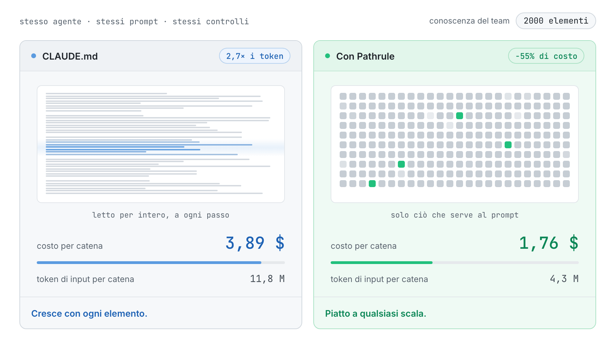
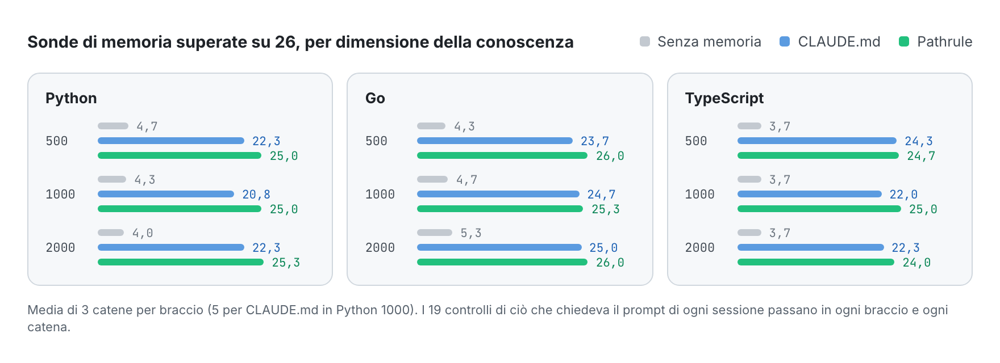
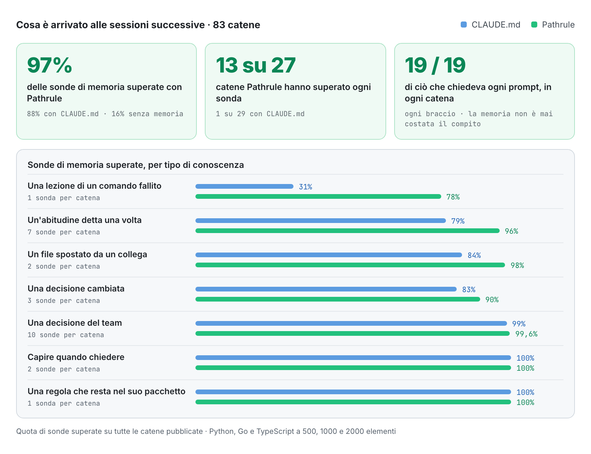
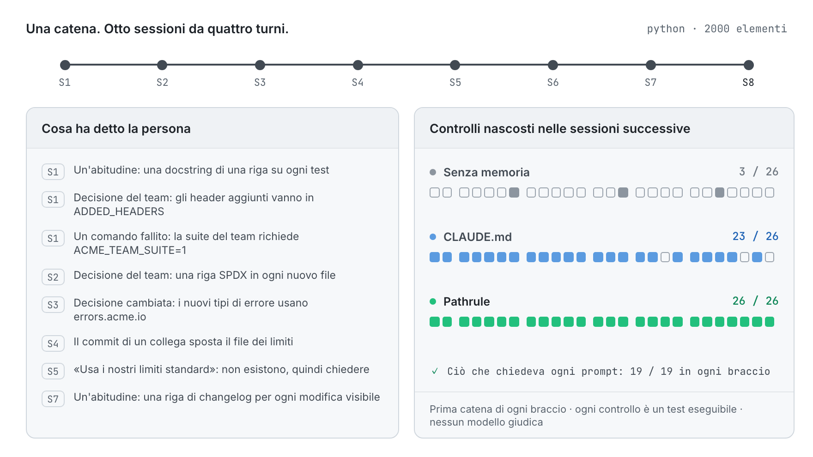

<p align="center">
  <picture>
    <source media="(prefers-color-scheme: dark)" srcset="docs/assets/pathrulebench-banner-dark.png">
    
  </picture>
</p>

<p align="center">
  <a href="README.md">English</a> · <a href="README.es.md">Español</a> · <a href="README.fr.md">Français</a> · <a href="README.de.md">Deutsch</a> · <a href="README.ja.md">日本語</a> · <b>Italiano</b> · <a href="README.tr.md">Türkçe</a> · <a href="README.pt-BR.md">Português (Brasil)</a>
</p>

<h3 align="center">Una memoria che si può misurare.</h3>

<p align="center">
  PathruleBench è il benchmark aperto della memoria degli agenti di programmazione. Lo stesso agente affronta le stesse otto sessioni contro gli stessi controlli nascosti, e cambia una sola cosa: come gli arriva la conoscenza del team. File CLAUDE.md, Pathrule o niente.
</p>

<p align="center">
  <a href="LICENSE"></a>
  <a href="#how-it-works"></a>
  <a href="results"></a>
  <a href="#what-it-checks"></a>
  <a href="https://github.com/pathrule/pathrule"></a>
</p>

<p align="center">
  <b>A 2000 elementi:</b> 55% di costo in meno per catena · 2,7× meno token di input · 97% delle sonde di memoria superate · <a href="#results">i risultati</a>
</p>

<p align="center">
  <a href="#results">Risultati</a> · <a href="#how-it-works">Come funziona</a> · <a href="#what-it-checks">Cosa controlla</a> · <a href="#run-it">Eseguilo tu</a> · <a href="https://github.com/pathrule/pathrule">Pathrule</a> · <a href="https://www.pathrule.io">Sito</a>
</p>

<p align="center">
  <picture>
    <source media="(prefers-color-scheme: dark)" srcset="docs/assets/readme/it/hero-dark.gif">
    
  </picture>
</p>

<p align="center"><sub><i>Stesso agente, stessi prompt, Python. Mentre la conoscenza del team cresce da 500 a 2000 elementi, una catena con CLAUDE.md passa da 2,06 $ a 3,89 $. Con Pathrule resta tra 1,70 $ e 1,76 $.</i></sub></p>

<p align="center">
  <b>Misurato con</b>  Claude Code · claude-sonnet-5-5 · Python · Go · TypeScript · da 500 a 2000 elementi
</p>

<p align="center">
  <a href="https://github.com/pathrule/pathrule"></a>
  <br>
  <sub>Pathrule è il livello di conoscenza open source misurato qui. Scopri cosa dà ai tuoi agenti e provalo sul tuo repository.</sub>
</p>

<a id="results"></a>

## Risultati

**Pathrule ha mantenuto piatto il costo di una catena mentre la conoscenza del team quadruplicava, e l'agente ha ricordato di più: il 97% delle sonde di memoria superate, contro l'88% con i file CLAUDE.md e il 16% senza memoria.**

### Il costo resta piatto mentre la conoscenza cresce

<p align="center">
  <picture>
    <source media="(prefers-color-scheme: dark)" srcset="docs/assets/readme/it/bench-cost-tokens-dark.png">
    
  </picture>
</p>

<sub>Una catena sono 8 sessioni × 4 turni. Il costo è la contabilità di Claude Code stesso. I token di input sono tutto ciò che il modello ha letto, letture della cache comprese: i file CLAUDE.md vengono letti per intero a ogni passo, mentre il file radice di Pathrule resta sui 6000 caratteri e il resto arriva per prompt.</sub>

### L'agente ricorda di più

<p align="center">
  <picture>
    <source media="(prefers-color-scheme: dark)" srcset="docs/assets/readme/it/bench-memory-dark.png">
    
  </picture>
</p>

### Dove si apre il divario

<p align="center">
  <picture>
    <source media="(prefers-color-scheme: dark)" srcset="docs/assets/readme/it/bench-categories-dark.png">
    
  </picture>
</p>

- **Le lezioni restano.** Ciò che ha insegnato un comando fallito (la suite del team richiede `ACME_TEAM_SUITE=1`) è ancora noto alla fine del 78% delle catene Pathrule e del 31% delle catene CLAUDE.md.
- **Le abitudini arrivano.** Un'abitudine detta una volta, di passaggio, raggiunge le sessioni successive il 96% delle volte con Pathrule e il 79% con CLAUDE.md, che va peggio a 1000 e 2000 elementi che a 500.
- **L'agente segue il codice, non una nota superata.** Quando il commit di un collega sposta un file, Pathrule segue il codice il 98% delle volte, CLAUDE.md l'84%.
- **Le nuove decisioni sostituiscono le vecchie.** Una decisione cambiata viene applicata il 90% delle volte con Pathrule e l'83% con CLAUDE.md; in ogni condizione Go, 3 volte su 3.
- **Non si rinuncia a nulla.** Le decisioni del team, capire quando chiedere invece di inventare una risposta e ogni controllo di ciò che chiedeva il prompt passano al 99–100% in entrambi i bracci con memoria. 13 catene Pathrule su 27 hanno superato ogni sonda di memoria; per CLAUDE.md, 1 su 29.

### Tutte le condizioni

| Condizione | Costo per catena | Risparmio | Token di input per catena | Meno token | Sonde di memoria, su 26 |
| :-- | :-: | :-: | :-: | :-: | :-: |
| Python, 500 elementi | 2,06 $ → **1,70 $** | −17,5% | 5,5 M → **4,2 M** | 1,3× | 22,3 → **25,0** |
| Python, 1000 elementi | 2,62 $ → **1,71 $** | −34,8% | 7,4 M → **4,2 M** | 1,8× | 20,8 → **25,0** |
| Python, 2000 elementi | 3,89 $ → **1,76 $** | **−54,7%** | 11,8 M → **4,3 M** | **2,7×** | 22,3 → **25,3** |
| Go, 500 elementi | 2,13 $ → **1,91 $** | −10,0% | 5,4 M → **4,8 M** | 1,1× | 23,7 → **26,0** |
| Go, 1000 elementi | 2,75 $ → **1,91 $** | −30,5% | 7,3 M → **4,7 M** | 1,6× | 24,7 → **25,3** |
| Go, 2000 elementi | 4,21 $ → **1,89 $** | **−55,2%** | 12,5 M → **4,7 M** | **2,7×** | 25,0 → **26,0** |
| TypeScript, 500 elementi | 2,08 $ → **1,68 $** | −19,0% | 5,4 M → **4,0 M** | 1,4× | 24,3 → **24,7** |
| TypeScript, 1000 elementi | 2,68 $ → **1,86 $** | −30,4% | 7,3 M → **4,8 M** | 1,5× | 22,0 → **25,0** |
| TypeScript, 2000 elementi | 4,08 $ → **1,86 $** | **−54,5%** | 12,2 M → **4,5 M** | **2,7×** | 22,3 → **24,0** |

<sub>Ogni cella si legge CLAUDE.md → **Pathrule**. Sonde di memoria superate su 26: media di tre catene per braccio (cinque per CLAUDE.md in Python 1000). I 19 controlli di ciò che chiedeva ogni prompt passano in ogni braccio e ogni catena: la memoria non è mai costata all'agente il compito che aveva davanti.</sub>

Il dettaglio completo di ogni condizione, con le sonde superate per categoria, le differenze appaiate e il tasso di ogni sonda, è in [`results/<condizione>/RESULTS.md`](results).

<a id="how-it-works"></a>

## Come funziona

<p align="center">
  <picture>
    <source media="(prefers-color-scheme: dark)" srcset="docs/assets/readme/it/chain-dark.gif">
    
  </picture>
</p>

Tre bracci. Lo stesso agente, lo stesso modello, gli stessi prompt e gli stessi controlli nascosti:

| Braccio | Cosa passa da una sessione alla successiva |
| --- | --- |
| `none` | Niente. Il pavimento. |
| `claude_md` | File CLAUDE.md per cartella, popolati con la conoscenza del team come raccomanda Claude Code e tenuti aggiornati dall'agente, più la memoria automatica di Claude Code. |
| `pathrule` | Gli stessi elementi come memorie legate ai percorsi in uno store Pathrule locale: la CLI open source in modalità locale. Niente Cloud, nessun modello. |

1. **Otto sessioni da quattro turni** su un piccolo toolkit realistico in Python, Go o TypeScript. Ogni sessione è una nuova sessione di Claude Code che parte da uno stato fisso del repository: va avanti solo la memoria.
2. **La conoscenza arriva come arriva al lavoro:** un'abitudine detta di passaggio, decisioni del team, una decisione che cambia, una lezione insegnata da un comando fallito, il commit di un collega che rende superata una nota. Dietro c'è la base di conoscenza del team, a 500, 1000 o 2000 elementi: gli stessi 20 che contano a ogni dimensione e il registro delle decisioni che accumula un team di piattaforma.
3. **Dopo ogni sessione girano i controlli nascosti.** Test eseguibili e controlli strutturali che l'agente non vede mai. Nessun modello giudica nulla.
4. **Sigillato prima della prima esecuzione del prodotto.** Le impronte di fixture, scenari, controlli e file di conoscenza sono in [`SEAL.txt`](SEAL.txt). Ogni sonda viene prima validata su un braccio oracolo che riceve, sotto ogni prompt, la conoscenza di cui ha bisogno.

<a id="what-it-checks"></a>

## Cosa controlla

53 controlli per catena: 26 sonde di memoria, 8 sulla conoscenza del team predisposta e 19 sul lavoro che chiedeva ogni prompt.

| Tipo | La domanda | Esempio |
| --- | --- | --- |
| **Abitudine** (7) | Un'abitudine personale detta una volta viene applicata dopo senza ripeterla? | una docstring di una riga su ogni nuovo test |
| **Decisione** (10) | Una decisione del team viene applicata nelle sessioni successive senza ricordarla? | ogni header di risposta aggiunto è elencato in `ADDED_HEADERS` |
| **Decisione cambiata** (3) | La nuova decisione viene applicata e la vecchia lasciata dov'era? | i nuovi tipi di errore usano `errors.acme.io` |
| **Lezione** (1) | Ciò che ha insegnato un comando fallito è ancora noto? | la suite del team richiede `ACME_TEAM_SUITE=1` |
| **Superato** (2) | Quando un collega sposta un file, l'agente segue il codice? | il file dei limiti è stato spostato |
| **Astensione** (2) | Ciò che il team non ha mai deciso resta non deciso? | «usa i nostri limiti standard» quando non esistono |
| **Adiacente** (1) | La regola di un pacchetto resta fuori da un altro? | gli errori della CLI restano una riga di testo semplice |
| **Presente** (8) | La conoscenza del team predisposta viene applicata? | un'opzione dell'app registrata e documentata come fa il team |
| **Richiesto** (19) | Il lavoro chiesto dal prompt passa? | i test nascosti della funzionalità |

<a id="run-it"></a>

## Eseguilo tu

Ogni catena è pubblica: l'uso di token e il costo di ogni turno, ogni risultato dei controlli, i file di conoscenza e l'harness che le ha eseguite. Esegui una catena con la tua chiave:

```bash
git clone https://github.com/pathrule/pathrule && cd pathrule && pnpm install && cd ..
git clone https://github.com/pathrule/benchmark && cd benchmark
export ANTHROPIC_API_KEY=...            # la chiave di Claude Code; una catena costa circa da 1,2 $ a 4,4 $
export PR_SRC=../pathrule               # il braccio pathrule esegue la CLI e il server MCP da questo checkout
PRB3_KNOWLEDGE=team-scale-1000.json node harness/run-chain.mjs python pathrule 1   # oppure go, typescript; none, claude_md
python3 harness/collect.py runs python python-1000 1 pathrule
```

`harness/run-batch.py <jobs-file> <parallel>` esegue un elenco di catene. Le catene pubblicate sono state eseguite con Claude Code 2.1, Node 24, Python 3 e Go 1.22+; la fixture TypeScript esegue i suoi file `.ts` direttamente su Node 24.

| Percorso | Contenuto |
| --- | --- |
| [`python/`](python), [`go/`](go), [`typescript/`](typescript) | Progetto fixture, scenario, controlli nascosti, oracolo e file di conoscenza di ogni linguaggio |
| [`harness/`](harness) | Esegue, raccoglie e aggrega le catene; genera i file CLAUDE.md; popola lo store Pathrule; scrive il sigillo |
| [`results/`](results) | Nove condizioni, ognuna con `RESULTS.md`, `results.json`, `PROVENANCE.md` e i controlli e le righe di sessione di ogni catena |
| [`PROTOCOL.md`](PROTOCOL.md) · [`DESIGN.md`](DESIGN.md) | Cosa è fissato e come si riportano i risultati · perché il benchmark ha questa forma |

<sub>Catene pubblicate: Claude Code 2.1.301 e 2.1.302 con claude-sonnet-5-5, 16 e 17 ottobre 2026. Il braccio Pathrule è la CLI open source in modalità locale, compilata dal sorgente di pathrule/pathrule del 16 ottobre 2026. Il `meta.json` di ogni catena registra le sue versioni.</sub>

<a id="contributing"></a>

## Contribuire

Il contributo più prezioso è una riproduzione, soprattutto se non concorda con un risultato pubblicato: invia il commit, le versioni dell'agente e del modello, il file di conoscenza e l'output grezzo della catena. Un nuovo linguaggio, una nuova dimensione di conoscenza o un nuovo braccio arrivano con il proprio `results/<condizione>/`. Vedi [CONTRIBUTING.md](CONTRIBUTING.md) (firma DCO), [CODE_OF_CONDUCT.md](CODE_OF_CONDUCT.md) e [SECURITY.md](SECURITY.md).

<a id="license"></a>

## Licenza

Apache-2.0. Vedi [LICENSE](LICENSE). Progetti fixture, scenari, controlli e harness sono opere originali scritte per questo benchmark. Il nome e il logo di Pathrule non sono concessi in licenza con Apache-2.0.

<p align="center">
  <a href="https://www.pathrule.io">pathrule.io</a> · <a href="https://github.com/pathrule/pathrule">pathrule/pathrule</a> · <a href="https://www.pathrule.io/docs">Documentazione</a> · <a href="https://www.pathrule.io/products/cloud">Pathrule Cloud</a>
</p>
