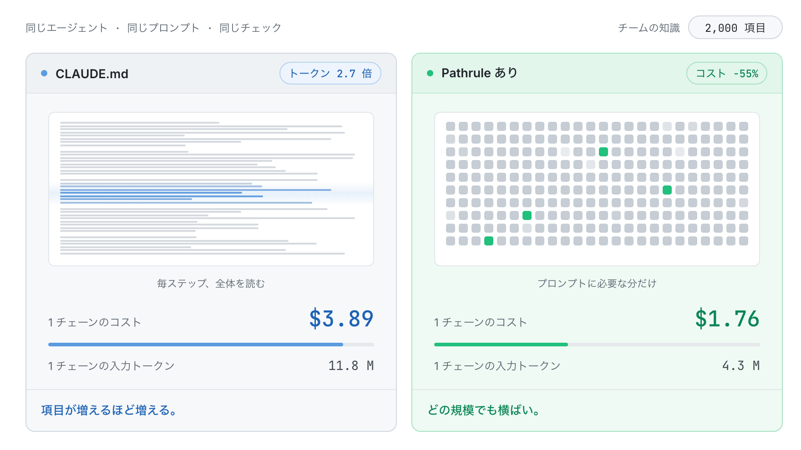
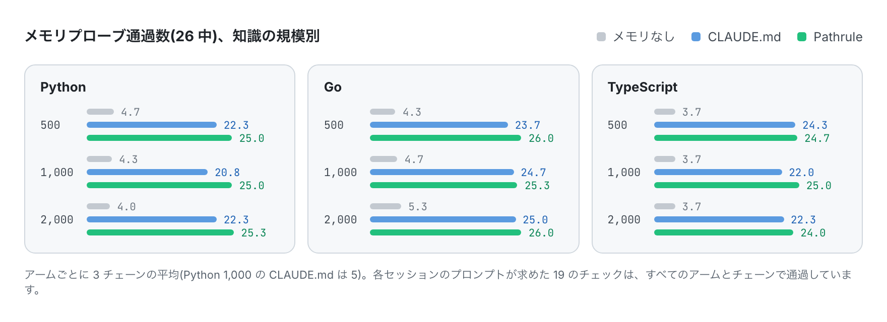
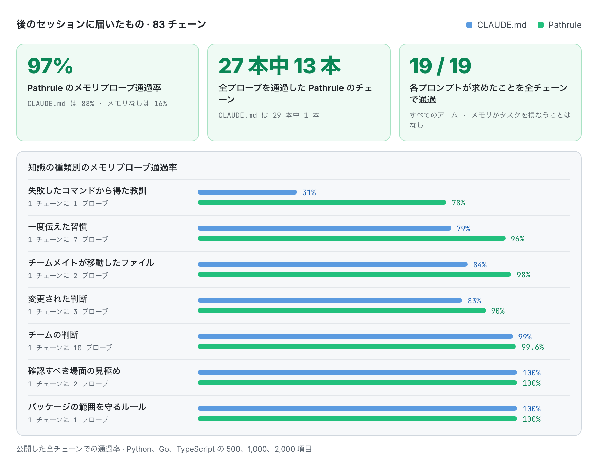
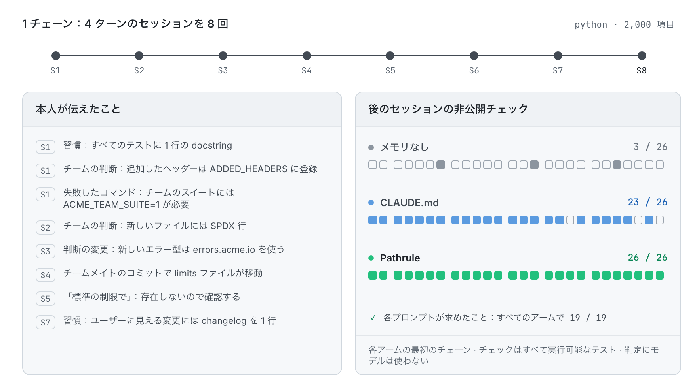

<p align="center">
  <picture>
    <source media="(prefers-color-scheme: dark)" srcset="docs/assets/pathrulebench-banner-dark.png">
    
  </picture>
</p>

<p align="center">
  <a href="README.md">English</a> · <a href="README.es.md">Español</a> · <a href="README.fr.md">Français</a> · <a href="README.de.md">Deutsch</a> · <b>日本語</b> · <a href="README.it.md">Italiano</a> · <a href="README.tr.md">Türkçe</a> · <a href="README.pt-BR.md">Português (Brasil)</a>
</p>

<h3 align="center">測れるメモリ。</h3>

<p align="center">
  PathruleBench は、コーディングエージェントのメモリを測るオープンなベンチマークです。同じエージェントが、同じ非公開チェックのもとで同じ 8 セッションを進め、変わるのはひとつだけ。チームの知識がどうエージェントに届くかです。CLAUDE.md ファイルか、Pathrule か、何もないか。
</p>

<p align="center">
  <a href="LICENSE"></a>
  <a href="#how-it-works"></a>
  <a href="results"></a>
  <a href="#what-it-checks"></a>
  <a href="https://github.com/pathrule/pathrule"></a>
</p>

<p align="center">
  <b>2,000 項目で：</b>1 チェーンのコスト 55% 減 · 入力トークン 1/2.7 · メモリプローブ通過率 97% · <a href="#results">結果を見る</a>
</p>

<p align="center">
  <a href="#results">結果</a> · <a href="#how-it-works">しくみ</a> · <a href="#what-it-checks">チェック内容</a> · <a href="#run-it">自分で実行する</a> · <a href="https://github.com/pathrule/pathrule">Pathrule</a> · <a href="https://www.pathrule.io">Web サイト</a>
</p>

<p align="center">
  <picture>
    <source media="(prefers-color-scheme: dark)" srcset="docs/assets/readme/ja/hero-dark.gif">
    
  </picture>
</p>

<p align="center"><sub><i>同じエージェント、同じプロンプト、Python。チームの知識が 500 項目から 2,000 項目に増えると、CLAUDE.md の 1 チェーンは $2.06 から $3.89 に。Pathrule では $1.70〜$1.76 のままです。</i></sub></p>

<p align="center">
  <b>測定環境</b>  Claude Code · claude-sonnet-5-5 · Python · Go · TypeScript · 500〜2,000 項目
</p>

<p align="center">
  <a href="https://github.com/pathrule/pathrule"></a>
  <br>
  <sub>Pathrule は、ここで測定したオープンソースのナレッジレイヤーです。エージェントに何をもたらすかを確かめて、あなたのリポジトリで試してください。</sub>
</p>

<a id="results"></a>

## 結果

**チームの知識が 4 倍に増えても、Pathrule は 1 チェーンのコストを横ばいに保ち、エージェントはより多くを覚えていました。メモリプローブの通過率は 97%。CLAUDE.md ファイルでは 88%、メモリなしでは 16% です。**

### 知識が増えてもコストは横ばい

<p align="center">
  <picture>
    <source media="(prefers-color-scheme: dark)" srcset="docs/assets/readme/ja/bench-cost-tokens-dark.png">
    
  </picture>
</p>

<sub>1 チェーンは 8 セッション × 4 ターンです。コストは Claude Code 自身の集計です。入力トークンはモデルが読んだすべてで、キャッシュ読み取りを含みます。CLAUDE.md は毎ステップ全体が読まれますが、Pathrule のルートファイルは約 6,000 文字のままで、残りはプロンプトごとに届きます。</sub>

### エージェントはより多くを覚えている

<p align="center">
  <picture>
    <source media="(prefers-color-scheme: dark)" srcset="docs/assets/readme/ja/bench-memory-dark.png">
    
  </picture>
</p>

### 差が開くところ

<p align="center">
  <picture>
    <source media="(prefers-color-scheme: dark)" srcset="docs/assets/readme/ja/bench-categories-dark.png">
    
  </picture>
</p>

- **教訓が残る**。失敗したコマンドから得たこと(チームのスイートには `ACME_TEAM_SUITE=1` が必要)は、Pathrule のチェーンの 78%、CLAUDE.md のチェーンの 31% で最後まで覚えられていました。
- **習慣が届く**。ついでに一度伝えた習慣は、Pathrule では 96%、CLAUDE.md では 79% の割合で後のセッションに届き、CLAUDE.md は 500 項目より 1,000 項目と 2,000 項目で下がります。
- **古いメモではなく、コードに従う**。チームメイトのコミットでファイルが移動したとき、Pathrule は 98%、CLAUDE.md は 84% の割合でコードに従いました。
- **新しい判断が古い判断に置き換わる**。変更された判断は Pathrule で 90%、CLAUDE.md で 83% 適用され、Go のすべての条件では 3 回中 3 回でした。
- **何も犠牲にしない**。チームの判断、答えを作らずに確認すべき場面の見極め、そしてプロンプトが求めた作業のチェックは、両方のメモリアームで 99–100% 通過しています。全メモリプローブを通過したチェーンは、Pathrule が 27 本中 13 本、CLAUDE.md が 29 本中 1 本です。

### すべての条件

| 条件 | 1 チェーンのコスト | 削減 | 1 チェーンの入力トークン | トークン比 | メモリプローブ(26 中) |
| :-- | :-: | :-: | :-: | :-: | :-: |
| Python、500 項目 | $2.06 → **$1.70** | −17.5% | 5.5 M → **4.2 M** | 1/1.3 | 22.3 → **25.0** |
| Python、1,000 項目 | $2.62 → **$1.71** | −34.8% | 7.4 M → **4.2 M** | 1/1.8 | 20.8 → **25.0** |
| Python、2,000 項目 | $3.89 → **$1.76** | **−54.7%** | 11.8 M → **4.3 M** | **1/2.7** | 22.3 → **25.3** |
| Go、500 項目 | $2.13 → **$1.91** | −10.0% | 5.4 M → **4.8 M** | 1/1.1 | 23.7 → **26.0** |
| Go、1,000 項目 | $2.75 → **$1.91** | −30.5% | 7.3 M → **4.7 M** | 1/1.6 | 24.7 → **25.3** |
| Go、2,000 項目 | $4.21 → **$1.89** | **−55.2%** | 12.5 M → **4.7 M** | **1/2.7** | 25.0 → **26.0** |
| TypeScript、500 項目 | $2.08 → **$1.68** | −19.0% | 5.4 M → **4.0 M** | 1/1.4 | 24.3 → **24.7** |
| TypeScript、1,000 項目 | $2.68 → **$1.86** | −30.4% | 7.3 M → **4.8 M** | 1/1.5 | 22.0 → **25.0** |
| TypeScript、2,000 項目 | $4.08 → **$1.86** | **−54.5%** | 12.2 M → **4.5 M** | **1/2.7** | 22.3 → **24.0** |

<sub>各セルは CLAUDE.md → **Pathrule** の順です。 26 のメモリプローブのうち通過した数。アームごとに 3 チェーンの平均(Python 1,000 の CLAUDE.md のみ 5 チェーン)。各プロンプトが求めた 19 のチェックは、すべてのアームとチェーンで通過しています。メモリが目の前のタスクを損なったことは一度もありません。</sub>

各条件の詳細(カテゴリ別の通過数、対応のある差、各プローブの通過率)は [`results/<条件>/RESULTS.md`](results) にあります。

<a id="how-it-works"></a>

## しくみ

<p align="center">
  <picture>
    <source media="(prefers-color-scheme: dark)" srcset="docs/assets/readme/ja/chain-dark.gif">
    
  </picture>
</p>

3 つのアーム。同じエージェント、同じモデル、同じプロンプト、同じ非公開チェック：

| アーム | セッションからセッションへ引き継がれるもの |
| --- | --- |
| `none` | 何もなし。下限です。 |
| `claude_md` | Claude Code が推奨する形でチームの知識を入れ、エージェントが最新に保つフォルダごとの CLAUDE.md ファイルと、Claude Code の自動メモリ。 |
| `pathrule` | 同じ項目を、ローカルの Pathrule ストアにパス単位のメモリとして。ローカルモードのオープンソース CLI です。Cloud もモデルも使いません。 |

1. **4 ターンのセッションを 8 回**、Python、Go、TypeScript の小さく現実的なツールキットで行います。各セッションは固定されたリポジトリの状態から始まる新しい Claude Code セッションで、引き継がれるのはメモリだけです。
2. **知識は実際の仕事と同じように届きます**。ついでに口にした習慣、チームの判断、変わる判断、失敗したコマンドから得た教訓、メモを古くするチームメイトのコミット。その背後に、500、1,000、2,000 項目のチームの知識ベースがあります。どの規模でも重要な同じ 20 項目と、プラットフォームチームが積み上げる判断の記録です。
3. **各セッションの後に非公開チェックが走ります**。エージェントが一度も見ない、実行可能なテストと構造チェックです。判定にモデルは一切使いません。
4. **最初の製品実行の前に封印**。フィクスチャ、シナリオ、チェック、知識ファイルのハッシュは [`SEAL.txt`](SEAL.txt) に記録されています。各プローブはまず、必要な知識を各プロンプトの下に貼り付けたオラクルアームで検証されます。

<a id="what-it-checks"></a>

## チェック内容

1 チェーンに 53 のチェック：26 のメモリプローブ、あらかじめ用意したチームの知識に 8、各プロンプトが求めた作業に 19。

| 種類 | 問い | 例 |
| --- | --- | --- |
| **習慣**(7) | 一度伝えた個人の習慣が、繰り返さなくても後で適用されるか | 新しいテストすべてに 1 行の docstring |
| **判断**(10) | チームの判断が、後のセッションで言われなくても適用されるか | 追加したレスポンスヘッダーはすべて `ADDED_HEADERS` に登録 |
| **変更された判断**(3) | 新しい判断が適用され、古いものはそのまま残されるか | 新しいエラー型は `errors.acme.io` を使う |
| **教訓**(1) | 失敗したコマンドから得たことを覚えているか | チームのスイートには `ACME_TEAM_SUITE=1` が必要 |
| **古い知識**(2) | チームメイトがファイルを移動したとき、コードに従うか | limits ファイルが移動した |
| **保留**(2) | チームが決めていないことを決めずにおくか | 存在しないのに「標準の制限で」 |
| **隣接**(1) | あるパッケージのルールが別のパッケージに及ばないか | CLI のエラーはプレーンテキスト 1 行のまま |
| **既存**(8) | あらかじめ用意したチームの知識が適用されるか | アプリのオプションをチームのやり方で登録・文書化 |
| **指示**(19) | プロンプトが求めた作業が通るか | 機能の非公開テスト |

<a id="run-it"></a>

## 自分で実行する

すべてのチェーンが公開されています。各ターンのトークン使用量とコスト、すべてのチェック結果、知識ファイル、それを実行したハーネス。自分のキーでチェーンを実行できます：

```bash
git clone https://github.com/pathrule/pathrule && cd pathrule && pnpm install && cd ..
git clone https://github.com/pathrule/benchmark && cd benchmark
export ANTHROPIC_API_KEY=...            # Claude Code のキー。1 チェーンは約 $1.2〜$4.4
export PR_SRC=../pathrule               # pathrule アームはこのチェックアウトから CLI と MCP サーバーを実行
PRB3_KNOWLEDGE=team-scale-1000.json node harness/run-chain.mjs python pathrule 1   # または go、typescript。none、claude_md
python3 harness/collect.py runs python python-1000 1 pathrule
```

`harness/run-batch.py <jobs-file> <parallel>` で複数のチェーンを実行できます。公開したチェーンは Claude Code 2.1、Node 24、Python 3、Go 1.22+ で実行しました。TypeScript のフィクスチャは `.ts` ファイルを Node 24 で直接実行します。

| パス | 内容 |
| --- | --- |
| [`python/`](python)、[`go/`](go)、[`typescript/`](typescript) | 各言語のフィクスチャ、シナリオ、非公開チェック、オラクル、知識ファイル |
| [`harness/`](harness) | チェーンの実行・収集・集計、CLAUDE.md ファイルの生成、Pathrule ストアの初期化、封印の書き出し |
| [`results/`](results) | 9 つの条件。それぞれに `RESULTS.md`、`results.json`、`PROVENANCE.md`、各チェーンのチェックとセッション記録 |
| [`PROTOCOL.md`](PROTOCOL.md) · [`DESIGN.md`](DESIGN.md) | 何を固定し、結果をどう報告するか · なぜこの形のベンチマークなのか |

<sub>公開チェーン：Claude Code 2.1.301 と 2.1.302、claude-sonnet-5-5、2026 年 10 月 16〜17 日。Pathrule アームは、pathrule/pathrule の 2026 年 10 月 16 日時点のソースからビルドした、ローカルモードのオープンソース CLI です。各チェーンの `meta.json` にバージョンが記録されています。</sub>

<a id="contributing"></a>

## コントリビュート

最も価値のある貢献は再現、とくに公開結果と食い違う再現です。コミット、エージェントとモデルのバージョン、知識ファイル、チェーンの生の出力を送ってください。新しい言語、知識の規模、アームは、それぞれの `results/<条件>/` とともに追加します。[CONTRIBUTING.md](CONTRIBUTING.md)(DCO 署名)、[CODE_OF_CONDUCT.md](CODE_OF_CONDUCT.md)と [SECURITY.md](SECURITY.md) を参照してください。

<a id="license"></a>

## ライセンス

Apache-2.0。[LICENSE](LICENSE) を参照してください。フィクスチャ、シナリオ、チェック、ハーネスは、このベンチマークのために書かれたオリジナルの成果物です。Pathrule の名称とロゴは Apache-2.0 ではライセンスされていません。

<p align="center">
  <a href="https://www.pathrule.io">pathrule.io</a> · <a href="https://github.com/pathrule/pathrule">pathrule/pathrule</a> · <a href="https://www.pathrule.io/docs">ドキュメント</a> · <a href="https://www.pathrule.io/products/cloud">Pathrule Cloud</a>
</p>
