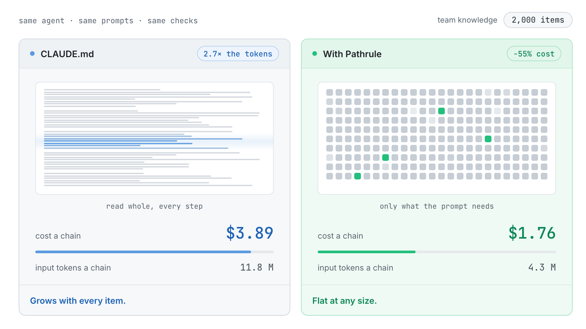
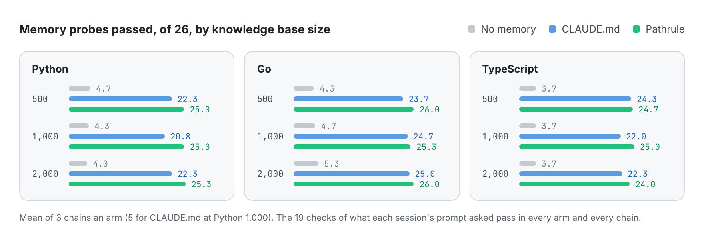
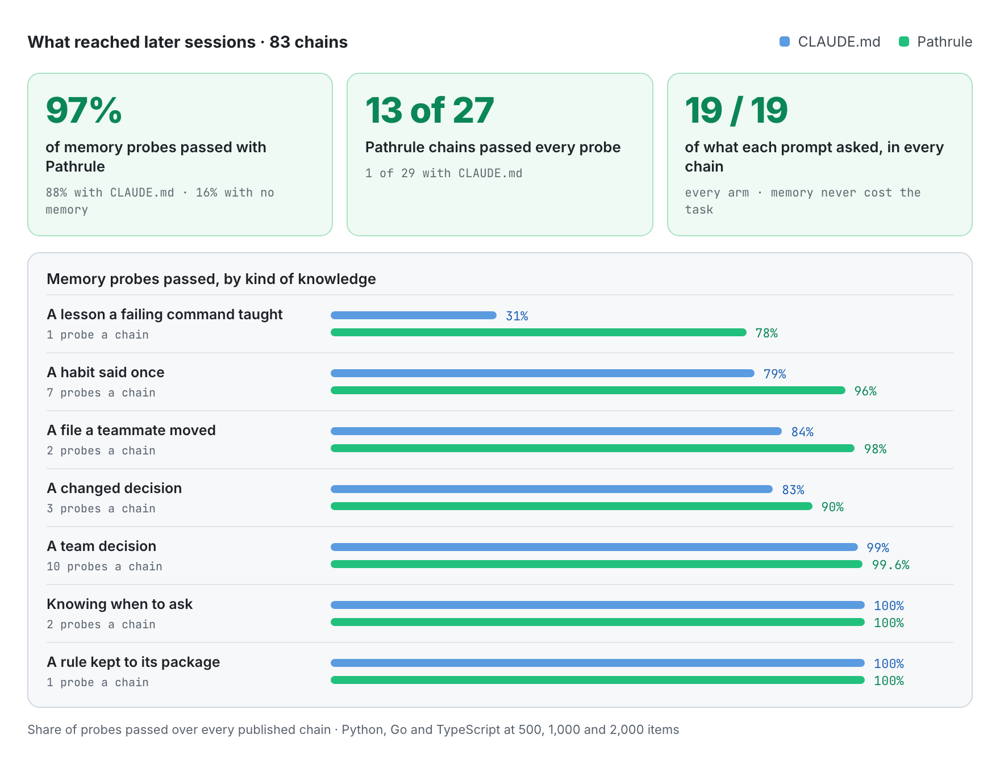
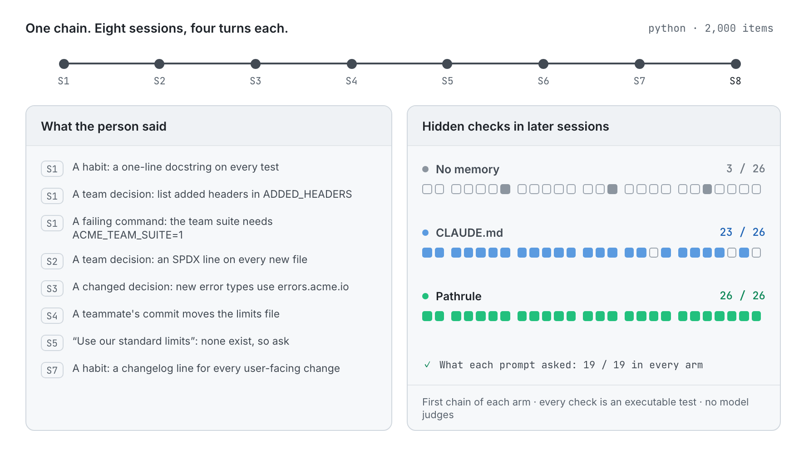

<p align="center">
  <picture>
    <source media="(prefers-color-scheme: dark)" srcset="docs/assets/pathrulebench-banner-dark.png">
    
  </picture>
</p>

<p align="center">
  <b>English</b> · <a href="README.es.md">Español</a> · <a href="README.fr.md">Français</a> · <a href="README.de.md">Deutsch</a> · <a href="README.ja.md">日本語</a> · <a href="README.it.md">Italiano</a> · <a href="README.tr.md">Türkçe</a> · <a href="README.pt-BR.md">Português (Brasil)</a>
</p>

<h3 align="center">Memory you can measure.</h3>

<p align="center">
  PathruleBench is the open benchmark for memory in coding agents. The same agent works through the same eight sessions against the same hidden checks, and one thing changes: how the team's knowledge reaches it. CLAUDE.md files, Pathrule, or nothing at all.
</p>

<p align="center">
  <a href="LICENSE"></a>
  <a href="#how-it-works"></a>
  <a href="results"></a>
  <a href="#what-it-checks"></a>
  <a href="https://github.com/pathrule/pathrule"></a>
</p>

<p align="center">
  <b>At 2,000 items:</b> 55% lower cost a chain · 2.7× fewer input tokens · 97% of memory probes passed · <a href="#results">the results</a>
</p>

<p align="center">
  <a href="#results">Results</a> · <a href="#how-it-works">How it works</a> · <a href="#what-it-checks">What it checks</a> · <a href="#run-it">Run it yourself</a> · <a href="https://github.com/pathrule/pathrule">Pathrule</a> · <a href="https://www.pathrule.io">Website</a>
</p>

<p align="center">
  <picture>
    <source media="(prefers-color-scheme: dark)" srcset="docs/assets/readme/en/hero-dark.gif">
    
  </picture>
</p>

<p align="center"><sub><i>Same agent, same prompts, Python. As the team's knowledge grows from 500 to 2,000 items, a chain with CLAUDE.md goes from $2.06 to $3.89. With Pathrule it stays between $1.70 and $1.76.</i></sub></p>

<p align="center">
  <b>Measured with</b>  Claude Code · claude-sonnet-5-5 · Python · Go · TypeScript · 500 to 2,000 items
</p>

<a id="results"></a>

## Results

**Pathrule kept the cost of a chain flat while the team's knowledge grew fourfold, and the agent remembered more: 97% of memory probes passed, against 88% with CLAUDE.md files and 16% with no memory.**

### Cost stays flat as knowledge grows

<p align="center">
  <picture>
    <source media="(prefers-color-scheme: dark)" srcset="docs/assets/readme/en/bench-cost-tokens-dark.png">
    
  </picture>
</p>

<sub>A chain is 8 sessions × 4 turns. Cost is Claude Code's own accounting. Input tokens are everything the model read, cache reads included: CLAUDE.md files are read whole on every step, while Pathrule's root file stays around 6k characters and the rest arrives per prompt.</sub>

### The agent remembers more

<p align="center">
  <picture>
    <source media="(prefers-color-scheme: dark)" srcset="docs/assets/readme/en/bench-memory-dark.png">
    
  </picture>
</p>

### Where the gap opens

<p align="center">
  <picture>
    <source media="(prefers-color-scheme: dark)" srcset="docs/assets/readme/en/bench-categories-dark.png">
    
  </picture>
</p>

- **Lessons stick.** What a failing command taught (the team suite needs `ACME_TEAM_SUITE=1`) is still known at the end of 78% of Pathrule chains, and 31% of CLAUDE.md chains.
- **Habits carry.** A habit said once, in passing, reaches later sessions 96% of the time with Pathrule and 79% with CLAUDE.md, which does worse at 1,000 and 2,000 items than at 500.
- **The agent follows the code, not a stale note.** When a teammate's commit moves a file, Pathrule follows the code 98% of the time, CLAUDE.md 84%.
- **New decisions replace old ones.** A changed decision is applied 90% of the time with Pathrule and 83% with CLAUDE.md; in every Go condition, 3 times out of 3.
- **Nothing is traded away.** Team decisions, knowing when to ask instead of inventing an answer, and every check of what the prompt asked pass at 99–100% in both memory arms. 13 of 27 Pathrule chains passed every memory probe; 1 of 29 CLAUDE.md chains did.

### Every condition

| Condition | Cost a chain | Saving | Input tokens a chain | Fewer tokens | Memory probes, of 26 |
| :-- | :-: | :-: | :-: | :-: | :-: |
| Python, 500 items | $2.06 → **$1.70** | −17.5% | 5.5 M → **4.2 M** | 1.3× | 22.3 → **25.0** |
| Python, 1,000 items | $2.62 → **$1.71** | −34.8% | 7.4 M → **4.2 M** | 1.8× | 20.8 → **25.0** |
| Python, 2,000 items | $3.89 → **$1.76** | **−54.7%** | 11.8 M → **4.3 M** | **2.7×** | 22.3 → **25.3** |
| Go, 500 items | $2.13 → **$1.91** | −10.0% | 5.4 M → **4.8 M** | 1.1× | 23.7 → **26.0** |
| Go, 1,000 items | $2.75 → **$1.91** | −30.5% | 7.3 M → **4.7 M** | 1.6× | 24.7 → **25.3** |
| Go, 2,000 items | $4.21 → **$1.89** | **−55.2%** | 12.5 M → **4.7 M** | **2.7×** | 25.0 → **26.0** |
| TypeScript, 500 items | $2.08 → **$1.68** | −19.0% | 5.4 M → **4.0 M** | 1.4× | 24.3 → **24.7** |
| TypeScript, 1,000 items | $2.68 → **$1.86** | −30.4% | 7.3 M → **4.8 M** | 1.5× | 22.0 → **25.0** |
| TypeScript, 2,000 items | $4.08 → **$1.86** | **−54.5%** | 12.2 M → **4.5 M** | **2.7×** | 22.3 → **24.0** |

<sub>Each cell reads CLAUDE.md → **Pathrule**. Mean of three chains an arm (five for CLAUDE.md at Python 1,000). The 19 checks of what each prompt asked pass in every arm and every chain: memory never cost the agent the task in front of it.</sub>

Every condition's full breakdown, with passes by category, paired differences and every probe's pass rate, is in [`results/<condition>/RESULTS.md`](results).

<a id="how-it-works"></a>

## How it works

<p align="center">
  <picture>
    <source media="(prefers-color-scheme: dark)" srcset="docs/assets/readme/en/chain-dark.gif">
    
  </picture>
</p>

Three arms. The same agent, the same model, the same prompts and the same hidden checks:

| Arm | What carries from one session to the next |
| --- | --- |
| `none` | Nothing. The floor. |
| `claude_md` | Per-folder CLAUDE.md files seeded with the team's knowledge the way Claude Code recommends, kept current by the agent, plus Claude Code's auto memory. |
| `pathrule` | The same items as path-scoped memories in a local Pathrule store: the open-source CLI in local mode. No Cloud, no model. |

1. **Eight sessions, four turns each,** on a small, realistic toolkit in Python, Go or TypeScript. Every session is a fresh Claude Code session that starts from a fixed repository state, so only memory carries forward.
2. **Knowledge arrives the way it does at work:** a habit mentioned in passing, team decisions, a decision that changes, a lesson a failing command teaches, a teammate's commit that makes a note stale. Behind it sits the team's knowledge base at 500, 1,000 or 2,000 items: the same 20 that matter at every size, and the decision log a platform team accumulates.
3. **Hidden checks run after every session.** Executable tests and structural checks the agent never sees. No model judges anything.
4. **Sealed before the first product run.** Fixtures, scenarios, checks and knowledge files are fingerprinted in [`SEAL.txt`](SEAL.txt). Every probe is validated first against an oracle arm that has the knowledge it needs pasted under each prompt.

<a id="what-it-checks"></a>

## What it checks

53 checks a chain: 26 memory probes, 8 on seeded team knowledge and 19 on the work each prompt asked for.

| Kind | The question | Example |
| --- | --- | --- |
| **Habit** (7) | Is a personal habit, said once, applied later without being repeated? | a one-line docstring on every new test |
| **Decision** (10) | Is a team decision applied in later sessions untold? | every added response header is listed in `ADDED_HEADERS` |
| **Changed decision** (3) | Is the new decision applied, and the old one left where it was? | new error types use `errors.acme.io` |
| **Lesson** (1) | Is what a failing command taught still known? | the team suite needs `ACME_TEAM_SUITE=1` |
| **Stale** (2) | When a teammate moves a file, does the agent follow the code? | the limits file moved |
| **Abstention** (2) | Is something the team never decided left undecided? | "use our standard limits" when none exist |
| **Adjacent** (1) | Does a rule for one package stay out of another? | CLI errors stay one plain-text line |
| **Present** (8) | Is the seeded team knowledge applied? | an app option registered and documented the team's way |
| **Told** (19) | Does the work the prompt asked for pass? | the feature's hidden tests |

<a id="run-it"></a>

## Run it yourself

Every chain is public: each turn's token usage and cost, every check result, the knowledge files and the harness that ran them. Run a chain against your own key:

```bash
git clone https://github.com/pathrule/pathrule && cd pathrule && pnpm install && cd ..
git clone https://github.com/pathrule/benchmark && cd benchmark
export ANTHROPIC_API_KEY=...            # Claude Code's key; a chain costs about $1.2 to $4.4
export PR_SRC=../pathrule               # the pathrule arm runs the CLI and MCP server from this checkout
PRB3_KNOWLEDGE=team-scale-1000.json node harness/run-chain.mjs python pathrule 1   # or go, typescript; none, claude_md
python3 harness/collect.py runs python python-1000 1 pathrule
```

`harness/run-batch.py <jobs-file> <parallel>` runs a list of chains. The published chains ran with Claude Code 2.1, Node 24, Python 3 and Go 1.22+; the TypeScript fixture runs its `.ts` files directly on Node 24.

| Path | What it holds |
| --- | --- |
| [`python/`](python), [`go/`](go), [`typescript/`](typescript) | Each language's fixture project, scenario, hidden checks, oracle and knowledge files |
| [`harness/`](harness) | Runs, collects and aggregates chains; renders the CLAUDE.md files; seeds the Pathrule store; writes the seal |
| [`results/`](results) | Nine conditions, each with `RESULTS.md`, `results.json`, `PROVENANCE.md` and every chain's checks and session rows |
| [`PROTOCOL.md`](PROTOCOL.md) · [`DESIGN.md`](DESIGN.md) | What is fixed and how results are reported · why the benchmark has this shape |

<sub>Published chains: Claude Code 2.1.301 and 2.1.302 with claude-sonnet-5-5, 16–17 October 2026. The Pathrule arm is the open-source CLI in local mode, built from the pathrule/pathrule source of 16 October 2026. Each chain's `meta.json` records its versions.</sub>

<a id="contributing"></a>

## Contributing

A reproduction is the most valuable contribution, above all one that disagrees with a published result: send the commit, the agent and model versions, the knowledge file and the raw chain output. A new language, knowledge size or arm comes with its own `results/<condition>/`. See [CONTRIBUTING.md](CONTRIBUTING.md) (DCO sign-off), [CODE_OF_CONDUCT.md](CODE_OF_CONDUCT.md) and [SECURITY.md](SECURITY.md).

<a id="license"></a>

## License

Apache-2.0. See [LICENSE](LICENSE). The fixture projects, scenarios, checks and harness are original work written for this benchmark. The Pathrule name and logo are not licensed under Apache-2.0.

<p align="center">
  <a href="https://www.pathrule.io">pathrule.io</a> · <a href="https://github.com/pathrule/pathrule">pathrule/pathrule</a> · <a href="https://www.pathrule.io/docs">Docs</a> · <a href="https://www.pathrule.io/products/cloud">Pathrule Cloud</a>
</p>
