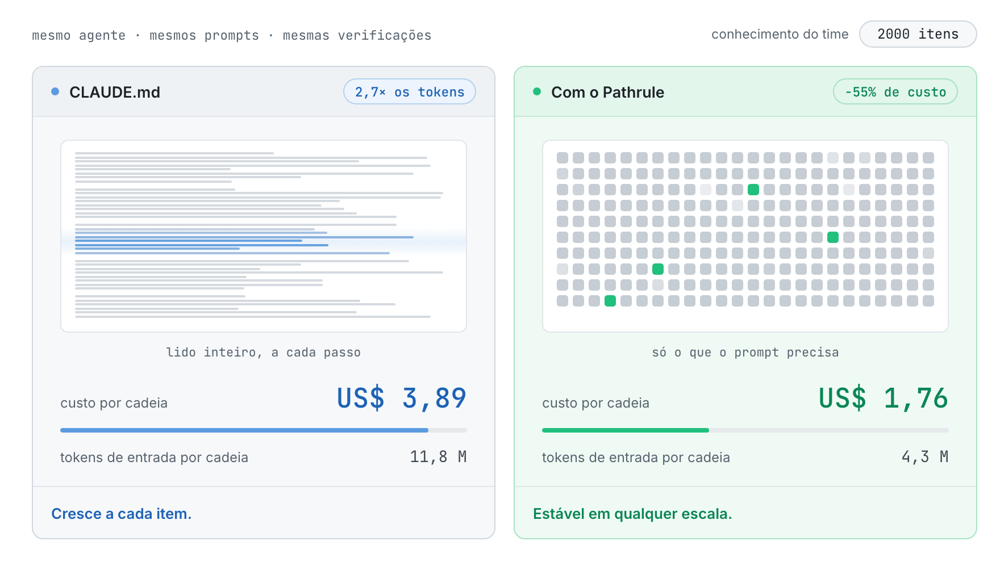
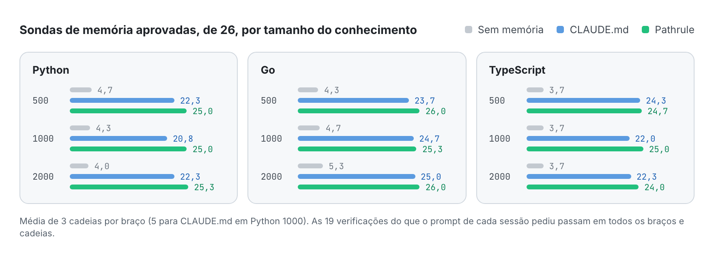
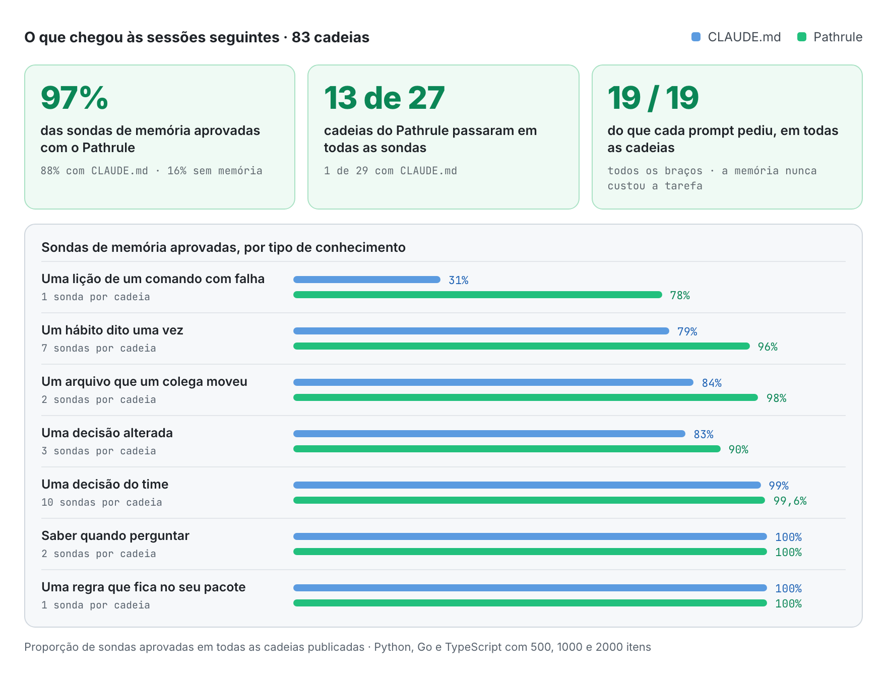
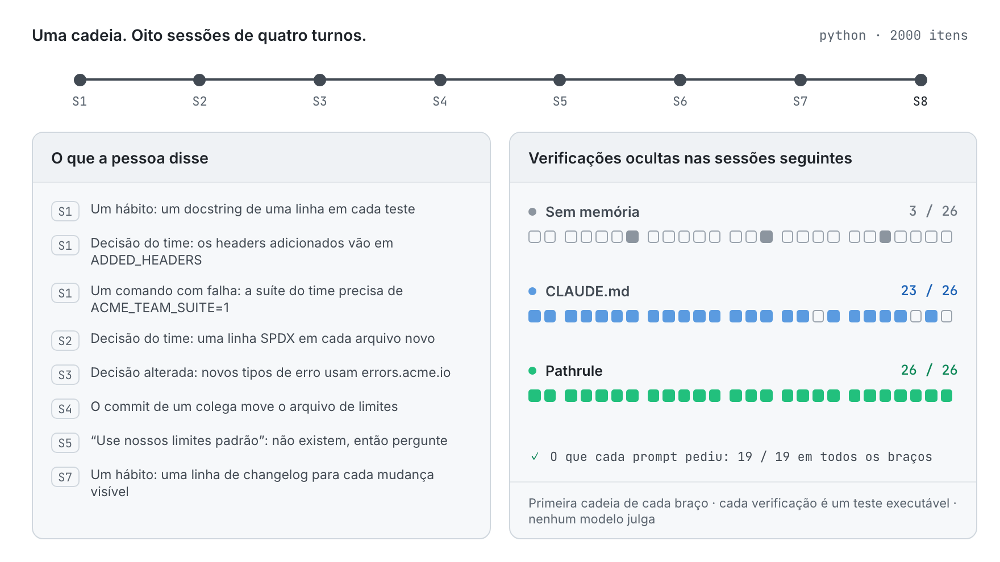

<p align="center">
  <picture>
    <source media="(prefers-color-scheme: dark)" srcset="docs/assets/pathrulebench-banner-dark.png">
    
  </picture>
</p>

<p align="center">
  <a href="README.md">English</a> · <a href="README.es.md">Español</a> · <a href="README.fr.md">Français</a> · <a href="README.de.md">Deutsch</a> · <a href="README.ja.md">日本語</a> · <a href="README.it.md">Italiano</a> · <a href="README.tr.md">Türkçe</a> · <b>Português (Brasil)</b>
</p>

<h3 align="center">Memória que dá para medir.</h3>

<p align="center">
  O PathruleBench é o benchmark aberto de memória para agentes de programação. O mesmo agente passa pelas mesmas oito sessões diante das mesmas verificações ocultas, e só uma coisa muda: como o conhecimento do time chega até ele. Arquivos CLAUDE.md, o Pathrule ou nada.
</p>

<p align="center">
  <a href="LICENSE"></a>
  <a href="#how-it-works"></a>
  <a href="results"></a>
  <a href="#what-it-checks"></a>
  <a href="https://github.com/pathrule/pathrule"></a>
</p>

<p align="center">
  <b>Com 2000 itens:</b> 55% menos custo por cadeia · 2,7× menos tokens de entrada · 97% das sondas de memória aprovadas · <a href="#results">os resultados</a>
</p>

<p align="center">
  <a href="#results">Resultados</a> · <a href="#how-it-works">Como funciona</a> · <a href="#what-it-checks">O que verifica</a> · <a href="#run-it">Rode você mesmo</a> · <a href="https://github.com/pathrule/pathrule">Pathrule</a> · <a href="https://www.pathrule.io">Site</a>
</p>

<p align="center">
  <picture>
    <source media="(prefers-color-scheme: dark)" srcset="docs/assets/readme/pt-BR/hero-dark.gif">
    
  </picture>
</p>

<p align="center"><sub><i>Mesmo agente, mesmos prompts, Python. Enquanto o conhecimento do time cresce de 500 para 2000 itens, uma cadeia com CLAUDE.md vai de US$ 2,06 para US$ 3,89. Com o Pathrule, fica entre US$ 1,70 e US$ 1,76.</i></sub></p>

<p align="center">
  <b>Medido com</b>  Claude Code · claude-sonnet-5-5 · Python · Go · TypeScript · de 500 a 2000 itens
</p>

<a id="results"></a>

## Resultados

**O Pathrule manteve estável o custo de uma cadeia enquanto o conhecimento do time quadruplicava, e o agente lembrou mais: 97% das sondas de memória aprovadas, contra 88% com arquivos CLAUDE.md e 16% sem memória.**

### O custo fica estável enquanto o conhecimento cresce

<p align="center">
  <picture>
    <source media="(prefers-color-scheme: dark)" srcset="docs/assets/readme/pt-BR/bench-cost-tokens-dark.png">
    
  </picture>
</p>

<sub>Uma cadeia são 8 sessões × 4 turnos. O custo é a contabilidade do próprio Claude Code. Tokens de entrada são tudo o que o modelo leu, leituras de cache incluídas: os arquivos CLAUDE.md são lidos inteiros a cada passo, enquanto o arquivo raiz do Pathrule fica em torno de 6000 caracteres e o resto chega por prompt.</sub>

### O agente lembra mais

<p align="center">
  <picture>
    <source media="(prefers-color-scheme: dark)" srcset="docs/assets/readme/pt-BR/bench-memory-dark.png">
    
  </picture>
</p>

### Onde a diferença se abre

<p align="center">
  <picture>
    <source media="(prefers-color-scheme: dark)" srcset="docs/assets/readme/pt-BR/bench-categories-dark.png">
    
  </picture>
</p>

- **As lições ficam.** O que um comando com falha ensinou (a suíte do time precisa de `ACME_TEAM_SUITE=1`) ainda é sabido no fim de 78% das cadeias do Pathrule e de 31% das cadeias do CLAUDE.md.
- **Os hábitos chegam.** Um hábito dito uma vez, de passagem, chega às sessões seguintes 96% das vezes com o Pathrule e 79% com o CLAUDE.md, que vai pior com 1000 e 2000 itens do que com 500.
- **O agente segue o código, não uma nota desatualizada.** Quando o commit de um colega move um arquivo, o Pathrule segue o código 98% das vezes; o CLAUDE.md, 84%.
- **Decisões novas substituem as antigas.** Uma decisão alterada é aplicada 90% das vezes com o Pathrule e 83% com o CLAUDE.md; em todas as condições de Go, 3 de 3.
- **Nada é sacrificado.** As decisões do time, saber quando perguntar em vez de inventar uma resposta e cada verificação do que o prompt pediu passam em 99–100% nos dois braços com memória. 13 de 27 cadeias do Pathrule passaram em todas as sondas de memória; do CLAUDE.md, 1 de 29.

### Todas as condições

| Condição | Custo por cadeia | Economia | Tokens de entrada por cadeia | Menos tokens | Sondas de memória, de 26 |
| :-- | :-: | :-: | :-: | :-: | :-: |
| Python, 500 itens | US$ 2,06 → **US$ 1,70** | −17,5% | 5,5 M → **4,2 M** | 1,3× | 22,3 → **25,0** |
| Python, 1000 itens | US$ 2,62 → **US$ 1,71** | −34,8% | 7,4 M → **4,2 M** | 1,8× | 20,8 → **25,0** |
| Python, 2000 itens | US$ 3,89 → **US$ 1,76** | **−54,7%** | 11,8 M → **4,3 M** | **2,7×** | 22,3 → **25,3** |
| Go, 500 itens | US$ 2,13 → **US$ 1,91** | −10,0% | 5,4 M → **4,8 M** | 1,1× | 23,7 → **26,0** |
| Go, 1000 itens | US$ 2,75 → **US$ 1,91** | −30,5% | 7,3 M → **4,7 M** | 1,6× | 24,7 → **25,3** |
| Go, 2000 itens | US$ 4,21 → **US$ 1,89** | **−55,2%** | 12,5 M → **4,7 M** | **2,7×** | 25,0 → **26,0** |
| TypeScript, 500 itens | US$ 2,08 → **US$ 1,68** | −19,0% | 5,4 M → **4,0 M** | 1,4× | 24,3 → **24,7** |
| TypeScript, 1000 itens | US$ 2,68 → **US$ 1,86** | −30,4% | 7,3 M → **4,8 M** | 1,5× | 22,0 → **25,0** |
| TypeScript, 2000 itens | US$ 4,08 → **US$ 1,86** | **−54,5%** | 12,2 M → **4,5 M** | **2,7×** | 22,3 → **24,0** |

<sub>Cada célula se lê CLAUDE.md → **Pathrule**. Sondas de memória aprovadas, de 26: média de três cadeias por braço (cinco para CLAUDE.md em Python 1000). As 19 verificações do que cada prompt pediu passam em todos os braços e cadeias: a memória nunca custou ao agente a tarefa à sua frente.</sub>

O detalhamento completo de cada condição, com as aprovações por categoria, as diferenças pareadas e a taxa de cada sonda, está em [`results/<condição>/RESULTS.md`](results).

<a id="how-it-works"></a>

## Como funciona

<p align="center">
  <picture>
    <source media="(prefers-color-scheme: dark)" srcset="docs/assets/readme/pt-BR/chain-dark.gif">
    
  </picture>
</p>

Três braços. O mesmo agente, o mesmo modelo, os mesmos prompts e as mesmas verificações ocultas:

| Braço | O que passa de uma sessão para a seguinte |
| --- | --- |
| `none` | Nada. O piso. |
| `claude_md` | Arquivos CLAUDE.md por pasta, semeados com o conhecimento do time do jeito que o Claude Code recomenda e mantidos em dia pelo agente, mais a memória automática do Claude Code. |
| `pathrule` | Os mesmos itens como memórias ligadas a caminhos num store local do Pathrule: a CLI open source em modo local. Sem Cloud, sem modelo. |

1. **Oito sessões de quatro turnos** num toolkit pequeno e realista em Python, Go ou TypeScript. Cada sessão é uma nova sessão do Claude Code que parte de um estado fixo do repositório: só a memória segue adiante.
2. **O conhecimento chega como chega no trabalho:** um hábito citado de passagem, decisões do time, uma decisão que muda, uma lição que um comando com falha ensina, o commit de um colega que deixa uma nota desatualizada. Por trás está a base de conhecimento do time, com 500, 1000 ou 2000 itens: os mesmos 20 que importam em todo tamanho e o registro de decisões que um time de plataforma acumula.
3. **Verificações ocultas rodam depois de cada sessão.** Testes executáveis e verificações estruturais que o agente nunca vê. Nenhum modelo julga nada.
4. **Selado antes da primeira execução do produto.** As impressões digitais de fixtures, cenários, verificações e arquivos de conhecimento estão em [`SEAL.txt`](SEAL.txt). Cada sonda é validada antes num braço oráculo que recebe, abaixo de cada prompt, o conhecimento de que precisa.

<a id="what-it-checks"></a>

## O que verifica

53 verificações por cadeia: 26 sondas de memória, 8 sobre o conhecimento semeado do time e 19 sobre o trabalho que cada prompt pediu.

| Tipo | A pergunta | Exemplo |
| --- | --- | --- |
| **Hábito** (7) | Um hábito pessoal dito uma vez é aplicado depois sem ser repetido? | um docstring de uma linha em cada teste novo |
| **Decisão** (10) | Uma decisão do time é aplicada em sessões seguintes sem ser lembrada? | todo header de resposta adicionado é listado em `ADDED_HEADERS` |
| **Decisão alterada** (3) | A decisão nova é aplicada e a antiga deixada onde estava? | novos tipos de erro usam `errors.acme.io` |
| **Lição** (1) | O que um comando com falha ensinou ainda é sabido? | a suíte do time precisa de `ACME_TEAM_SUITE=1` |
| **Desatualizado** (2) | Quando um colega move um arquivo, o agente segue o código? | o arquivo de limites foi movido |
| **Abstenção** (2) | O que o time nunca decidiu continua sem decisão? | "use nossos limites padrão" quando eles não existem |
| **Adjacente** (1) | A regra de um pacote fica fora de outro? | erros da CLI continuam numa linha de texto simples |
| **Presente** (8) | O conhecimento semeado do time é aplicado? | uma opção do app registrada e documentada do jeito do time |
| **Pedido** (19) | O trabalho que o prompt pediu passa? | os testes ocultos da funcionalidade |

<a id="run-it"></a>

## Rode você mesmo

Todas as cadeias são públicas: o uso de tokens e o custo de cada turno, cada resultado de verificação, os arquivos de conhecimento e o harness que as executou. Rode uma cadeia com a sua própria chave:

```bash
git clone https://github.com/pathrule/pathrule && cd pathrule && pnpm install && cd ..
git clone https://github.com/pathrule/benchmark && cd benchmark
export ANTHROPIC_API_KEY=...            # a chave do Claude Code; uma cadeia custa cerca de US$ 1,2 a US$ 4,4
export PR_SRC=../pathrule               # o braço pathrule roda a CLI e o servidor MCP a partir deste checkout
PRB3_KNOWLEDGE=team-scale-1000.json node harness/run-chain.mjs python pathrule 1   # ou go, typescript; none, claude_md
python3 harness/collect.py runs python python-1000 1 pathrule
```

`harness/run-batch.py <jobs-file> <parallel>` roda uma lista de cadeias. As cadeias publicadas rodaram com Claude Code 2.1, Node 24, Python 3 e Go 1.22+; o fixture de TypeScript executa seus arquivos `.ts` direto no Node 24.

| Caminho | O que contém |
| --- | --- |
| [`python/`](python), [`go/`](go), [`typescript/`](typescript) | O projeto fixture, o cenário, as verificações ocultas, o oráculo e os arquivos de conhecimento de cada linguagem |
| [`harness/`](harness) | Roda, coleta e agrega cadeias; gera os arquivos CLAUDE.md; semeia o store do Pathrule; escreve o selo |
| [`results/`](results) | Nove condições, cada uma com `RESULTS.md`, `results.json`, `PROVENANCE.md` e as verificações e linhas de sessão de cada cadeia |
| [`PROTOCOL.md`](PROTOCOL.md) · [`DESIGN.md`](DESIGN.md) | O que é fixo e como os resultados são reportados · por que o benchmark tem esse formato |

<sub>Cadeias publicadas: Claude Code 2.1.301 e 2.1.302 com claude-sonnet-5-5, 16 e 17 de outubro de 2026. O braço do Pathrule é a CLI open source em modo local, compilada a partir do código de pathrule/pathrule de 16 de outubro de 2026. O `meta.json` de cada cadeia registra suas versões.</sub>

<a id="contributing"></a>

## Contribuir

A contribuição mais valiosa é uma reprodução, sobretudo uma que discorde de um resultado publicado: envie o commit, as versões do agente e do modelo, o arquivo de conhecimento e a saída bruta da cadeia. Uma nova linguagem, um novo tamanho de conhecimento ou um novo braço chegam com o próprio `results/<condição>/`. Veja [CONTRIBUTING.md](CONTRIBUTING.md) (assinatura DCO), [CODE_OF_CONDUCT.md](CODE_OF_CONDUCT.md) e [SECURITY.md](SECURITY.md).

<a id="license"></a>

## Licença

Apache-2.0. Veja [LICENSE](LICENSE). Os projetos fixture, os cenários, as verificações e o harness são obras originais escritas para este benchmark. O nome e o logo do Pathrule não são licenciados sob a Apache-2.0.

<p align="center">
  <a href="https://www.pathrule.io">pathrule.io</a> · <a href="https://github.com/pathrule/pathrule">pathrule/pathrule</a> · <a href="https://www.pathrule.io/docs">Documentação</a> · <a href="https://www.pathrule.io/products/cloud">Pathrule Cloud</a>
</p>
