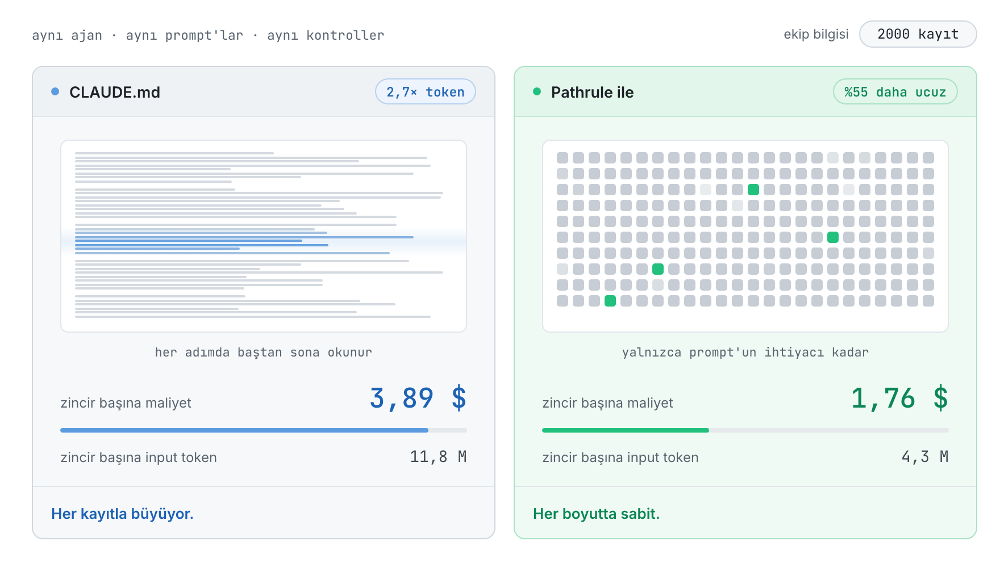
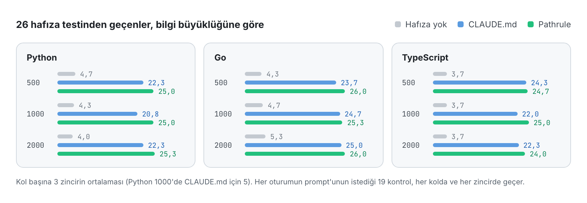
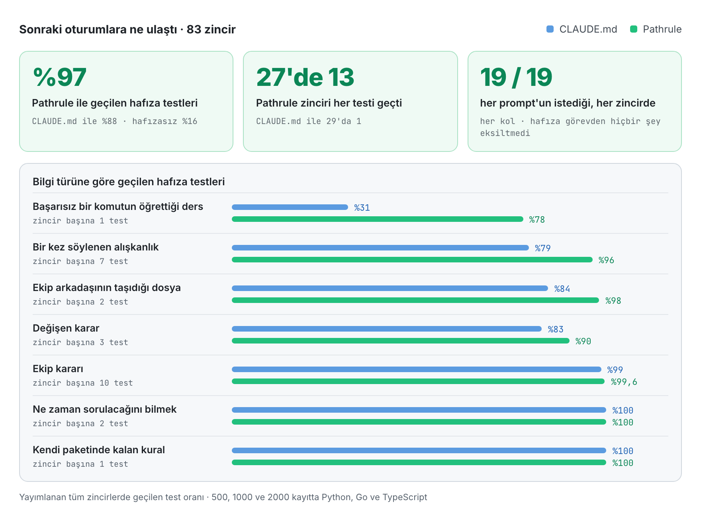
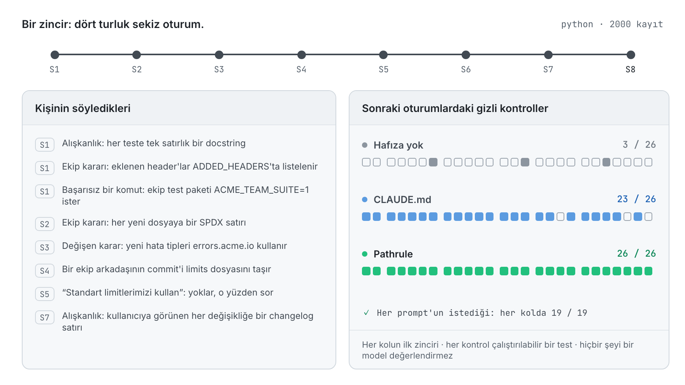

<p align="center">
  <picture>
    <source media="(prefers-color-scheme: dark)" srcset="docs/assets/pathrulebench-banner-dark.png">
    
  </picture>
</p>

<p align="center">
  <a href="README.md">English</a> · <a href="README.es.md">Español</a> · <a href="README.fr.md">Français</a> · <a href="README.de.md">Deutsch</a> · <a href="README.ja.md">日本語</a> · <a href="README.it.md">Italiano</a> · <b>Türkçe</b> · <a href="README.pt-BR.md">Português (Brasil)</a>
</p>

<h3 align="center">Ölçülebilen hafıza.</h3>

<p align="center">
  PathruleBench, kodlama ajanlarında hafıza için açık benchmark'tır. Aynı ajan, aynı gizli kontrollere karşı aynı sekiz oturumu çalışır ve tek bir şey değişir: ekibin bilgisinin ajana nasıl ulaştığı. CLAUDE.md dosyaları, Pathrule ya da hiçbir şey.
</p>

<p align="center">
  <a href="LICENSE"></a>
  <a href="#how-it-works"></a>
  <a href="results"></a>
  <a href="#what-it-checks"></a>
  <a href="https://github.com/pathrule/pathrule"></a>
</p>

<p align="center">
  <b>2000 kayıtta:</b> zincir başına %55 daha düşük maliyet · 2,7× daha az input token · hafıza testlerinin %97'si geçildi · <a href="#results">sonuçlar</a>
</p>

<p align="center">
  <a href="#results">Sonuçlar</a> · <a href="#how-it-works">Nasıl çalışır</a> · <a href="#what-it-checks">Neyi kontrol eder</a> · <a href="#run-it">Kendin çalıştır</a> · <a href="https://github.com/pathrule/pathrule">Pathrule</a> · <a href="https://www.pathrule.io">Web sitesi</a>
</p>

<p align="center">
  <picture>
    <source media="(prefers-color-scheme: dark)" srcset="docs/assets/readme/tr/hero-dark.gif">
    
  </picture>
</p>

<p align="center"><sub><i>Aynı ajan, aynı prompt'lar, Python. Ekip bilgisi 500'den 2000 kayda çıkarken CLAUDE.md ile bir zincir 2,06 $'dan 3,89 $'a çıkıyor. Pathrule ile 1,70 $ ile 1,76 $ arasında kalıyor.</i></sub></p>

<p align="center">
  <b>Ölçüldüğü ortam</b>  Claude Code · claude-sonnet-5-5 · Python · Go · TypeScript · 500 ile 2000 kayıt arası
</p>

<a id="results"></a>

## Sonuçlar

**Ekip bilgisi dört katına çıkarken Pathrule zincir maliyetini sabit tuttu ve ajan daha fazlasını hatırladı: hafıza testlerinin %97'si geçildi; CLAUDE.md dosyalarıyla %88, hafızasız %16.**

### Bilgi büyüdükçe maliyet sabit kalıyor

<p align="center">
  <picture>
    <source media="(prefers-color-scheme: dark)" srcset="docs/assets/readme/tr/bench-cost-tokens-dark.png">
    
  </picture>
</p>

<sub>Bir zincir 8 oturum × 4 turdur. Maliyet Claude Code'un kendi hesabıdır. Input token, modelin okuduğu her şeydir, cache okumaları dahil: CLAUDE.md dosyaları her adımda baştan sona okunur; Pathrule'un kök dosyası ise 6000 karakter civarında kalır, gerisi prompt başına gelir.</sub>

### Ajan daha fazlasını hatırlıyor

<p align="center">
  <picture>
    <source media="(prefers-color-scheme: dark)" srcset="docs/assets/readme/tr/bench-memory-dark.png">
    
  </picture>
</p>

### Farkın açıldığı yer

<p align="center">
  <picture>
    <source media="(prefers-color-scheme: dark)" srcset="docs/assets/readme/tr/bench-categories-dark.png">
    
  </picture>
</p>

- **Dersler kalıcı.** Başarısız bir komutun öğrettiği şey (ekip test paketi `ACME_TEAM_SUITE=1` ister), Pathrule zincirlerinin %78'inde, CLAUDE.md zincirlerinin %31'inde sona kadar biliniyor.
- **Alışkanlıklar taşınıyor.** Laf arasında bir kez söylenen bir alışkanlık, sonraki oturumlara Pathrule ile %96, CLAUDE.md ile %79 oranında ulaşıyor; CLAUDE.md 1000 ve 2000 kayıtta, 500 kayda göre daha kötü.
- **Ajan eski nota değil, koda uyuyor.** Bir ekip arkadaşının commit'i bir dosyayı taşıdığında Pathrule %98, CLAUDE.md %84 oranında kodu takip ediyor.
- **Yeni karar eskisinin yerini alıyor.** Değişen bir karar Pathrule ile %90, CLAUDE.md ile %83 oranında uygulanıyor; Go'nun her koşulunda 3'te 3.
- **Hiçbir şeyden ödün verilmiyor.** Ekip kararları, cevap uydurmak yerine ne zaman sorulacağını bilmek ve prompt'un istediği işin her kontrolü, iki hafıza kolunda da %99–100 geçiyor. 27 Pathrule zincirinden 13'ü her hafıza testini geçti; 29 CLAUDE.md zincirinden yalnızca 1'i.

### Her koşul

| Koşul | Zincir başına maliyet | Tasarruf | Zincir başına input token | Daha az token | Hafıza testi, 26'da |
| :-- | :-: | :-: | :-: | :-: | :-: |
| Python, 500 kayıt | 2,06 $ → **1,70 $** | −%17,5 | 5,5 M → **4,2 M** | 1,3× | 22,3 → **25,0** |
| Python, 1000 kayıt | 2,62 $ → **1,71 $** | −%34,8 | 7,4 M → **4,2 M** | 1,8× | 20,8 → **25,0** |
| Python, 2000 kayıt | 3,89 $ → **1,76 $** | **−%54,7** | 11,8 M → **4,3 M** | **2,7×** | 22,3 → **25,3** |
| Go, 500 kayıt | 2,13 $ → **1,91 $** | −%10,0 | 5,4 M → **4,8 M** | 1,1× | 23,7 → **26,0** |
| Go, 1000 kayıt | 2,75 $ → **1,91 $** | −%30,5 | 7,3 M → **4,7 M** | 1,6× | 24,7 → **25,3** |
| Go, 2000 kayıt | 4,21 $ → **1,89 $** | **−%55,2** | 12,5 M → **4,7 M** | **2,7×** | 25,0 → **26,0** |
| TypeScript, 500 kayıt | 2,08 $ → **1,68 $** | −%19,0 | 5,4 M → **4,0 M** | 1,4× | 24,3 → **24,7** |
| TypeScript, 1000 kayıt | 2,68 $ → **1,86 $** | −%30,4 | 7,3 M → **4,8 M** | 1,5× | 22,0 → **25,0** |
| TypeScript, 2000 kayıt | 4,08 $ → **1,86 $** | **−%54,5** | 12,2 M → **4,5 M** | **2,7×** | 22,3 → **24,0** |

<sub>Her hücre CLAUDE.md → **Pathrule** sırasıyla okunur. 26 hafıza testinden geçilenler, kol başına üç zincirin ortalaması (Python 1000'de CLAUDE.md için beş). Her prompt'un istediği 19 kontrol, her kolda ve her zincirde geçer: hafıza ajana önündeki görevi hiç kaybettirmedi.</sub>

Her koşulun tam dökümü (kategoriye göre geçenler, eşleştirilmiş farklar ve her testin geçme oranı) [`results/<koşul>/RESULTS.md`](results) içinde.

<a id="how-it-works"></a>

## Nasıl çalışır

<p align="center">
  <picture>
    <source media="(prefers-color-scheme: dark)" srcset="docs/assets/readme/tr/chain-dark.gif">
    
  </picture>
</p>

Üç kol. Aynı ajan, aynı model, aynı prompt'lar ve aynı gizli kontroller:

| Kol | Bir oturumdan diğerine ne taşınır |
| --- | --- |
| `none` | Hiçbir şey. Taban çizgisi. |
| `claude_md` | Ekip bilgisiyle Claude Code'un önerdiği şekilde doldurulmuş, ajanın güncel tuttuğu klasör bazlı CLAUDE.md dosyaları ve Claude Code'un otomatik hafızası. |
| `pathrule` | Aynı kayıtlar, lokal bir Pathrule deposunda yola bağlı memory'ler olarak: lokal modda açık kaynak CLI. Cloud yok, model yok. |

1. **Dört turluk sekiz oturum,** Python, Go ya da TypeScript'te küçük, gerçekçi bir araç seti üzerinde. Her oturum, sabit bir repository durumundan başlayan yeni bir Claude Code oturumudur; ileriye yalnızca hafıza taşınır.
2. **Bilgi, işte nasıl geliyorsa öyle gelir:** laf arasında söylenen bir alışkanlık, ekip kararları, değişen bir karar, başarısız bir komutun öğrettiği ders, bir notu eskiten bir ekip arkadaşı commit'i. Arkasında 500, 1000 ya da 2000 kayıtlık ekip bilgi tabanı durur: her boyutta önemli olan aynı 20 kayıt ve bir platform ekibinin biriktirdiği karar günlüğü.
3. **Her oturumdan sonra gizli kontroller çalışır.** Ajanın hiç görmediği çalıştırılabilir testler ve yapısal kontroller. Hiçbir şeyi bir model değerlendirmez.
4. **İlk ürün koşusundan önce mühürlenir.** Fixture'lar, senaryolar, kontroller ve bilgi dosyalarının parmak izleri [`SEAL.txt`](SEAL.txt) içinde kayıtlıdır. Her test önce, ihtiyaç duyduğu bilgi her prompt'un altına yapıştırılmış bir oracle koluna karşı doğrulanır.

<a id="what-it-checks"></a>

## Neyi kontrol eder

Zincir başına 53 kontrol: 26 hafıza testi, önceden yüklenmiş ekip bilgisi için 8 ve her prompt'un istediği iş için 19.

| Tür | Soru | Örnek |
| --- | --- | --- |
| **Alışkanlık** (7) | Bir kez söylenen kişisel bir alışkanlık, tekrarlanmadan sonra uygulanıyor mu? | her yeni teste tek satırlık bir docstring |
| **Karar** (10) | Bir ekip kararı, sonraki oturumlarda söylenmeden uygulanıyor mu? | eklenen her response header'ı `ADDED_HEADERS` içinde listelenir |
| **Değişen karar** (3) | Yeni karar uygulanıyor, eskisi olduğu yerde bırakılıyor mu? | yeni hata tipleri `errors.acme.io` kullanır |
| **Ders** (1) | Başarısız bir komutun öğrettiği şey hâlâ biliniyor mu? | ekip test paketi `ACME_TEAM_SUITE=1` ister |
| **Eskimiş bilgi** (2) | Bir ekip arkadaşı bir dosyayı taşıdığında ajan koda uyuyor mu? | limits dosyası taşındı |
| **Çekimserlik** (2) | Ekibin hiç karar vermediği bir şey kararsız bırakılıyor mu? | hiçbiri yokken "standart limitlerimizi kullan" |
| **Komşu paket** (1) | Bir paketin kuralı başka bir pakete taşmıyor mu? | CLI hataları tek satır düz metin kalır |
| **Mevcut bilgi** (8) | Önceden yüklenmiş ekip bilgisi uygulanıyor mu? | bir uygulama seçeneği ekibin yöntemiyle kaydedilip belgelenir |
| **İstenen iş** (19) | Prompt'un istediği iş geçiyor mu? | özelliğin gizli testleri |

<a id="run-it"></a>

## Kendin çalıştır

Her zincir açık: her turun token kullanımı ve maliyeti, her kontrol sonucu, bilgi dosyaları ve onları koşan harness. Kendi anahtarınla bir zincir çalıştır:

```bash
git clone https://github.com/pathrule/pathrule && cd pathrule && pnpm install && cd ..
git clone https://github.com/pathrule/benchmark && cd benchmark
export ANTHROPIC_API_KEY=...            # Claude Code'un anahtarı; bir zincir yaklaşık 1,2–4,4 $ tutar
export PR_SRC=../pathrule               # pathrule kolu CLI'ı ve MCP sunucusunu bu checkout'tan çalıştırır
PRB3_KNOWLEDGE=team-scale-1000.json node harness/run-chain.mjs python pathrule 1   # ya da go, typescript; none, claude_md
python3 harness/collect.py runs python python-1000 1 pathrule
```

`harness/run-batch.py <jobs-file> <parallel>` bir zincir listesini çalıştırır. Yayımlanan zincirler Claude Code 2.1, Node 24, Python 3 ve Go 1.22+ ile koşuldu; TypeScript fixture'ı `.ts` dosyalarını doğrudan Node 24'te çalıştırır.

| Yol | İçerdiği |
| --- | --- |
| [`python/`](python), [`go/`](go), [`typescript/`](typescript) | Her dilin fixture projesi, senaryosu, gizli kontrolleri, oracle'ı ve bilgi dosyaları |
| [`harness/`](harness) | Zincirleri çalıştırır, toplar ve birleştirir; CLAUDE.md dosyalarını üretir; Pathrule deposunu doldurur; mührü yazar |
| [`results/`](results) | Dokuz koşul; her biri `RESULTS.md`, `results.json`, `PROVENANCE.md` ve her zincirin kontrolleri ile oturum kayıtlarıyla |
| [`PROTOCOL.md`](PROTOCOL.md) · [`DESIGN.md`](DESIGN.md) | Neyin sabit olduğu ve sonuçların nasıl raporlandığı · benchmark'ın neden bu şekilde kurulduğu |

<sub>Yayımlanan zincirler: claude-sonnet-5-5 ile Claude Code 2.1.301 ve 2.1.302, 16–17 Ekim 2026. Pathrule kolu, pathrule/pathrule'un 16 Ekim 2026 tarihli kaynağından derlenmiş, lokal modda açık kaynak CLI'dır. Her zincirin `meta.json` dosyası kendi sürümlerini kaydeder.</sub>

<a id="contributing"></a>

## Katkıda bulun

En değerli katkı bir tekrar koşusudur, özellikle de yayımlanan bir sonuçla uyuşmayanı: commit'i, ajan ve model sürümlerini, bilgi dosyasını ve ham zincir çıktısını gönder. Yeni bir dil, bilgi boyutu ya da kol kendi `results/<koşul>/` klasörüyle gelir. Bkz. [CONTRIBUTING.md](CONTRIBUTING.md) (DCO imzası), [CODE_OF_CONDUCT.md](CODE_OF_CONDUCT.md) ve [SECURITY.md](SECURITY.md).

<a id="license"></a>

## Lisans

Apache-2.0. [LICENSE](LICENSE) dosyasına bak. Fixture projeleri, senaryolar, kontroller ve harness bu benchmark için yazılmış özgün çalışmalardır. Pathrule adı ve logosu Apache-2.0 kapsamında lisanslanmamıştır.

<p align="center">
  <a href="https://www.pathrule.io">pathrule.io</a> · <a href="https://github.com/pathrule/pathrule">pathrule/pathrule</a> · <a href="https://www.pathrule.io/docs">Dokümantasyon</a> · <a href="https://www.pathrule.io/products/cloud">Pathrule Cloud</a>
</p>
